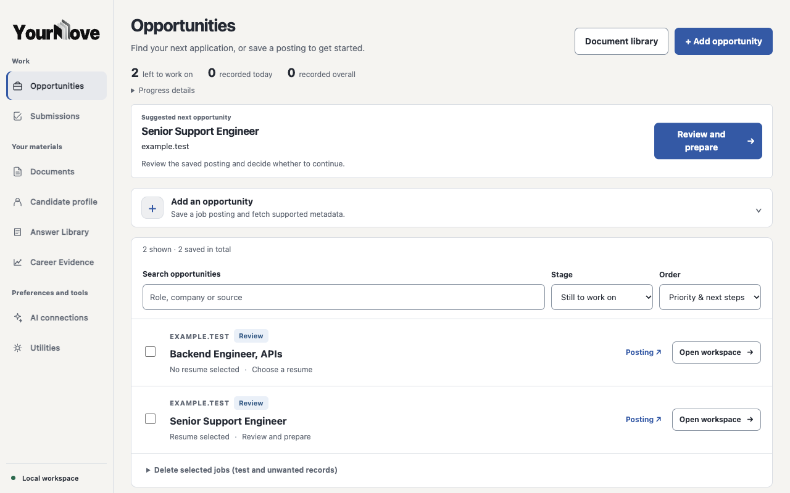
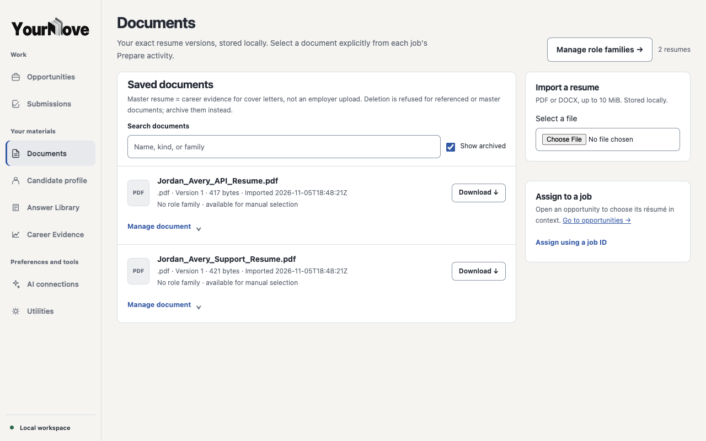
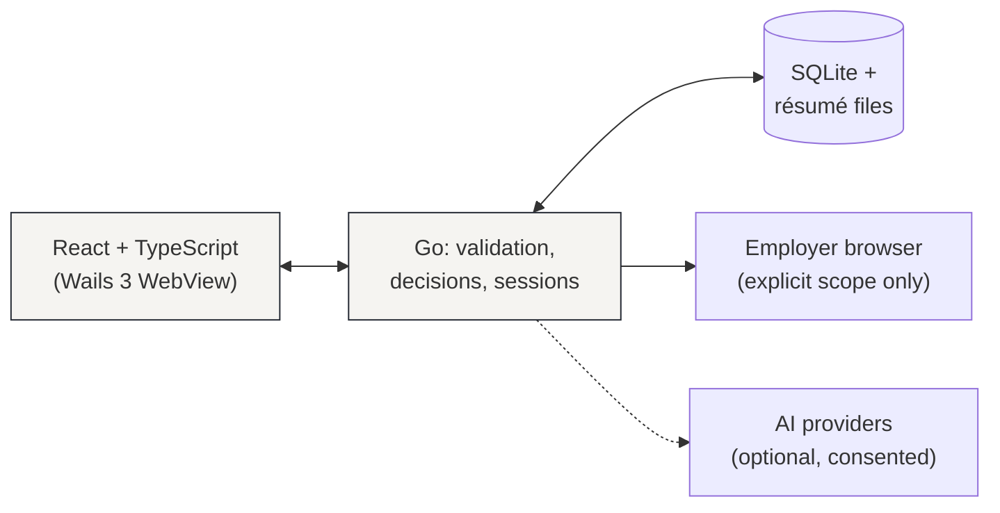

<p align="center">
  <picture>
    <source media="(prefers-color-scheme: dark)" srcset="docs/images/yourmove-wordmark-dark.png">
    
  </picture>
</p>

<p align="center"><strong>Less repetition. More of what matters.</strong></p>

<p align="center">
A local-first Mac workspace for working through job applications —
opportunities, résumés, answers, cover letters, and records of what you personally submitted.
</p>

<p align="center">
  <a href="https://github.com/jenksed/yourmove-go/releases/download/v0.1.0/YourMove-0.1.0-macOS-arm64.dmg"><strong>Download for Mac</strong></a> ·
  <a href="https://www.yourmove.run/docs/availability/">Installation guide</a> ·
  <a href="#one-workspace-for-the-whole-application">See how it works</a>
</p>

<p align="center"><sub>macOS Technical Alpha v0.1.0 · Apple Silicon · Unnotarized testers build</sub></p>

---

## The work nobody should have to repeat

Every application asks for the same things in a slightly different shape: the résumé, the experience, the answers, the cover letter, the form. So applicants retype their own history, re-upload the same file, and re-learn each employer's process — then start over for the next opening.

YourMove keeps one workspace where that work accumulates. Save an opportunity once. Keep every résumé version. Reuse answers and writing you already approved. When a form needs filling, bring exactly what you chose — then review it on the employer's site and submit it yourself.

Nothing here applies for you, submits for you, or decides for you. **The applicant is the only submitter YourMove recognizes.**

## One workspace for the whole application



*Genuine interface, synthetic example data.*

A guided pass through one application:

**Opportunity → Prepare → Review → Submit yourself → Record**

1. **Save** a posting to your Opportunities list; supported sources fill in the details.
2. **Prepare** in the workspace: pick the résumé for this job, answer questions once, write or generate a cover letter from approved material.
3. **Review** the employer form in context. Where a form is supported, you authorize each fill explicitly and inspect the result. Unsupported fields stay manual — never silently skipped.
4. **Submit yourself** on the employer's website. YourMove has no control that submits.
5. **Record** the completed application, pinned to the exact résumé version and materials you used.



## Why it works this way

| Instead of… | YourMove… |
| --- | --- |
| Re-uploading résumés everywhere | Stores exact PDF/DOCX versions locally, with role routing and revision history |
| Rewriting the same answers | Keeps an approved Answer Library and reusable career evidence |
| Black-box autofill | Fills supported fields only after explicit authorization, shows the result, never replays uncertain transfers |
| "Submitted" checkmarks you can't verify | Records completion only after you confirm you submitted it yourself |
| Your data on someone's server | Keeps records on your Mac (`~/Library/Application Support/YourMove`); AI is optional and consent-gated |

## Try the alpha

**Requires:** Apple Silicon Mac, macOS 26+. Chrome/Chromium only matters for assisted form filling.

1. Download [**YourMove-0.1.0-macOS-arm64.dmg**](https://github.com/jenksed/yourmove-go/releases/download/v0.1.0/YourMove-0.1.0-macOS-arm64.dmg) ([checksum `d84ef968…124f4bee`](https://github.com/jenksed/yourmove-go/releases/download/v0.1.0/YourMove-0.1.0-macOS-arm64.dmg.sha256)).
2. Open the DMG, drag YourMove into Applications.
3. Open it. macOS will warn that the app is unverified — this alpha is ad-hoc signed, not notarized. Choose **Done** (not Move to Trash).
4. Open **System Settings → Privacy & Security** and choose **Open Anyway** for YourMove — a per-app approval, not a settings change — then open the app again.

Full steps with screenshots: [installation guide](https://www.yourmove.run/docs/availability/). A plain ZIP of the same build is on the [release page](https://github.com/jenksed/yourmove-go/releases/tag/v0.1.0).

## Trust and transparency

- Your records live on your computer. Posting fetches, AI generations, and form fills are separate network actions that need your explicit request or authorization.
- AI assistance is optional. Unconfigured providers fail clearly without touching saved work, and no provider becomes the authority over your material.
- Filling support is qualified on controlled fixtures, not every employer site. Expect manual steps; unsupported fields stay manual.
- This alpha has no automatic updates and no Developer ID notarization. Career Discovery and Career Studio are parked for a future version; Career Evidence ships and feeds cover letters.
- The project is GPL-3.0-only, including the pinned Career Discovery module source published with the release.

## Under the hood



Go owns validation, saved state, document identity, consent, browser effects, and completion records. React owns presentation and disposable drafts — no parallel rules, no second data store. One SQLite writer; employer sessions never survive restart.

| Inspect | What it does |
| --- | --- |
| [`internal/app/`](internal/app/) | Routes, protected transport, workspace operations, submission recording |
| [`internal/application/browser/`](internal/application/browser/) | Read-only inspection, authorized field/document transfer, Chromium + Firefox engines |
| [`internal/storage/`](internal/storage/) | SQLite schema, workspace paths, durable state |
| [`frontend/src/features/`](frontend/src/features/) | React screens: opportunities, resumes, application workspace, career |
| [`docs/CODEBASE_GUIDE.md`](docs/CODEBASE_GUIDE.md) | Source map: routes, handlers, persistence, browser commands |
| [`docs/releases/0.1.0-log.md`](docs/releases/0.1.0-log.md) | Complete v0.1.0 record: scope, evidence, gates, assets, exclusions |

```sh
go test ./...              # browser mode + shared logic
go test -tags desktop ./...  # macOS desktop build path
```

## Build from source

The published [source archives](https://github.com/jenksed/yourmove-go/releases/tag/v0.1.0) build without private access. Download both the application source and the Career Discovery module source, then point Go at the local copy:

```sh
mkdir yourmove-build && cd yourmove-build
unzip ../YourMove-0.1.0-source.zip
unzip ../yourmove-career-discovery-*-source.zip
go mod edit -replace \
  github.com/jenksed/yourmove-career-discovery=./yourmove-career-discovery-v0.0.0-20261027151338-47aa7d49b55e
cd frontend && pnpm install --frozen-lockfile && pnpm run build && cd ..
go build ./...
```

This exact path was verified against the published archives. For day-to-day development, see [TRY_IT.md](docs/TRY_IT.md) (note: contributors with access to the private module repository don't need the `replace` step).

## Related: YourMove Realize

[YourMove Realize](https://github.com/jenksed/yourmove-realize-demo) ([live demo](https://realize.yourmove.run/)) is a separate AI-guided career-discovery project: an interactive interview that helps people recognize strengths hidden in work they've already done. It shares YourMove's belief that AI should assist judgment rather than replace it — but it is **not** part of this desktop release.

## Help shape what's next

This alpha exists to learn from real application work. If a workflow blocks you, a field misbehaves, or the guidance confuses you, that report is the most valuable contribution:

[Report a bug](https://github.com/jenksed/yourmove-go/issues/new?template=bug-report.md) · [Share experience feedback](https://github.com/jenksed/yourmove-go/issues/new?template=experience-feedback.md) · [Feedback and privacy guidance](docs/FEEDBACK.md)

Please keep resumes, answers, credentials, and unredacted employer forms out of public issues. If the project earns its place in your job search, you can [support independent development](https://ko-fi.com/yourmove) — optional, and never tied to access.

## License

Copyright (C) 2026 Joshua Jenks. YourMove's original source code is licensed under the [GNU General Public License version 3 only](LICENSE) (`GPL-3.0-only`). The pinned Career Discovery module snapshot ships under the same terms (see its NOTICE). Third-party dependencies and assets retain their applicable licenses.
