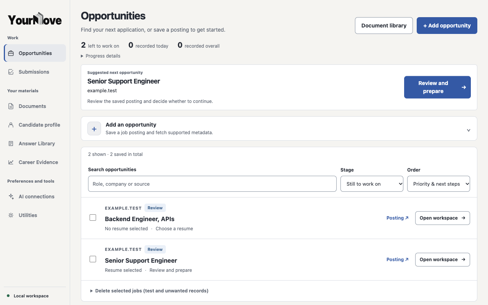
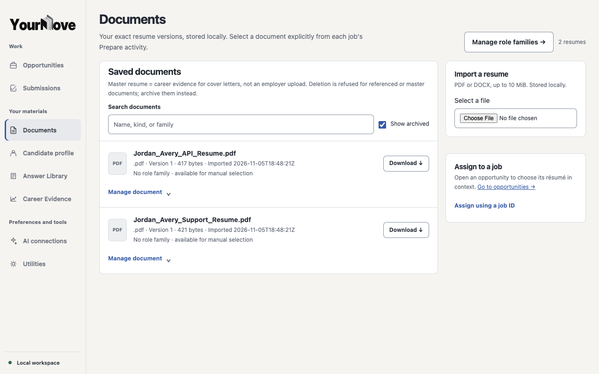
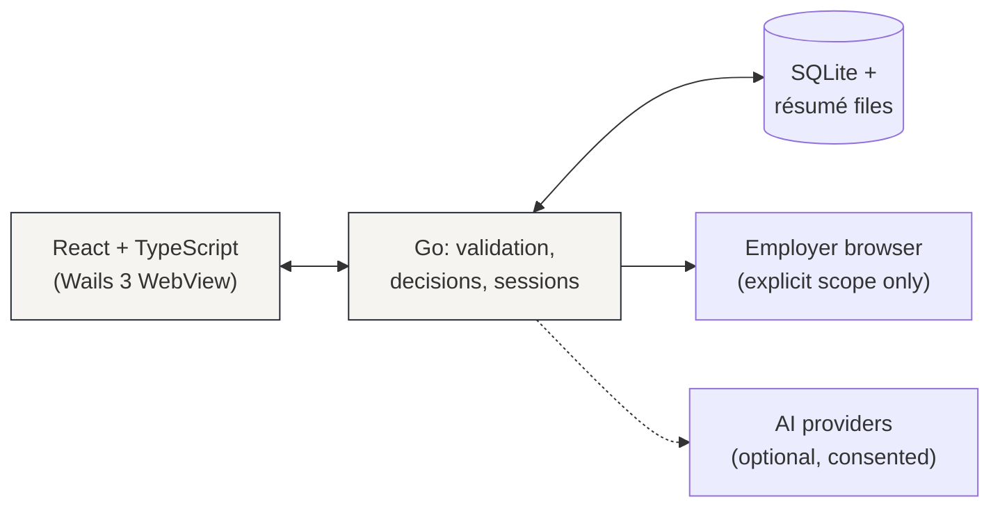

<p align="center">
  <picture>
    <source media="(prefers-color-scheme: dark)" srcset="docs/images/yourmove-wordmark-dark.png">
    
  </picture>
</p>

<p align="center"><strong>Less repetition. More of what matters.</strong></p>

<p align="center">
A local-first Mac workspace for working through job applications —
opportunities, résumés, answers, cover letters, and records of what you personally submitted.
</p>

<p align="center">
  <a href="https://github.com/jenksed/yourmove-go/releases/download/v0.3.0/YourMove-0.3.0-macOS-arm64-unnotarized.zip"><strong>Download for Mac</strong></a> ·
  <a href="https://www.yourmove.run/docs/availability/">Installation guide</a> ·
  <a href="#one-workspace-for-the-whole-application">See how it works</a>
</p>

<p align="center">v0.3.0 build 1 is available as a manual-install technical alpha. It is not a notarized macOS release.</p>

<p align="center"><sub>v0.3.0 build 1 · Apple Silicon · macOS 26+ · Ad-hoc signed / unnotarized</sub></p>

---

## The work nobody should have to repeat

Every application asks for the same things in a slightly different shape: the résumé, the experience, the answers, the cover letter, the form. So applicants retype their own history, re-upload the same file, and re-learn each employer's process — then start over for the next opening.

YourMove keeps one workspace where that work accumulates. Save an opportunity once. Keep every résumé version. Reuse answers and writing you already approved. When a form needs filling, bring exactly what you chose — then review it on the employer's site and submit it yourself.

Nothing here applies for you, submits for you, or decides for you. **The applicant is the only submitter YourMove recognizes.**

## One workspace for the whole application



*Interface screenshot from an earlier build, using synthetic data. v0.3.0 includes updated Opportunities and Questions layouts.*

**New in v0.3.0:** Focus, Saved for Later, and History simplify opportunity review; the Questions workspace better protects unsaved writing; posting-closure feedback and explicit profile Fill authorization help keep the next action clear. [Full release notes](https://github.com/jenksed/yourmove-go/releases/tag/v0.3.0).

A guided pass through one application:

**Opportunity → Prepare → Review → Submit yourself → Record**

1. **Save** a posting to your Opportunities list; supported sources fill in the details.
2. **Prepare** in the workspace: pick the résumé for this job, answer questions once, write or generate a cover letter from approved material.
3. **Review** the employer form in context. Where a form is supported, you authorize each fill explicitly and inspect the result. Unsupported fields stay manual — never silently skipped.
4. **Submit yourself** on the employer's website. YourMove has no control that submits.
5. **Record** the completed application, pinned to the exact résumé version and materials you used.



## Why it works this way

| Instead of… | YourMove… |
| --- | --- |
| Re-uploading résumés everywhere | Stores exact PDF/DOCX versions locally, with role routing and revision history |
| Rewriting the same answers | Keeps an approved Answer Library and reusable career evidence |
| Black-box autofill | Fills supported fields only after explicit authorization, shows the result, never replays uncertain transfers |
| "Submitted" checkmarks you can't verify | Records completion only after you confirm you submitted it yourself |
| Your data on someone's server | Keeps records on your Mac (`~/Library/Application Support/YourMove`); AI is optional and consent-gated |

## Try the alpha

**Current download:** [YourMove v0.3.0 build 1 for macOS (Apple Silicon)](https://github.com/jenksed/yourmove-go/releases/download/v0.3.0/YourMove-0.3.0-macOS-arm64-unnotarized.zip) · [release notes and checksums](https://github.com/jenksed/yourmove-go/releases/tag/v0.3.0)

**Requires:** Apple Silicon Mac running macOS 26.0 or later. A compatible installed Chrome/Chromium browser is required only for assisted employer-form operations. This ZIP is **ad-hoc signed and not notarized**; Intel Macs and Windows/Linux are not supported by this release.

1. Download the v0.3.0 ZIP. Verify its SHA-256 before installing: `b270101ca81f33a19f7829951c0061976ff73ad2cdcaa35854b43b1467b5c365`. The release also includes `SHA256SUMS-v0.3.0.txt`.
2. If upgrading, quit YourMove and back up the **entire** workspace (normally `~/Library/Application Support/YourMove`, including `jobs.db` and `resumes/`). Keep the backup until you've verified your data in the new version.
3. Open the ZIP in Finder and move `YourMove.app` to Applications, replacing the previous installed app if necessary. Keep the workspace directory in place.
4. Launch YourMove. If macOS blocks the unnotarized application, choose **Done** and, only if you trust the source and verified the checksum, open **System Settings → Privacy & Security → Open Anyway** for YourMove. This is a per-app exception; do not disable Gatekeeper globally. [Apple's guidance](https://support.apple.com/en-us/102445).
5. After an upgrade, verify your opportunities, résumé attachments, saved answers, and letters. If anything is missing, quit and preserve your full backup.

**Upgrades to v0.3.0 are manual.** The existing stable update channel does not offer v0.3.0 to users of earlier versions. The v0.3.0 application includes an in-app update checker, but any future updater-delivered release must be separately packaged, signed and qualified; installing and restarting require user approval. See the [v0.3.0 release notes](https://github.com/jenksed/yourmove-go/releases/tag/v0.3.0) for details.

## Trust and transparency

- Your records live on your computer. Posting fetches, AI generations, and form fills are separate network actions that need your explicit request or authorization.
- AI assistance is optional. Unconfigured providers fail clearly without touching saved work, and no provider becomes the authority over your material.
- Filling support is qualified on controlled fixtures, not every employer site. Expect manual steps; unsupported fields stay manual.
- This build is ad-hoc signed and unnotarized. It includes an in-app update checker, but v0.3.0 itself is distributed by manual installation. Future updater releases require a signed update package and user approval. Career Discovery and Career Studio are outside this desktop alpha; Career Evidence supports cover-letter work.
- The project is GPL-3.0-only, including the pinned Career Discovery module source published with the release.

## Under the hood



Go owns validation, saved state, document identity, consent, browser effects, and completion records. React owns presentation and disposable drafts — no parallel rules, no second data store. One SQLite writer; employer sessions never survive restart.

| Inspect | What it does |
| --- | --- |
| [`internal/app/`](internal/app/) | Routes, protected transport, workspace operations, submission recording |
| [`internal/application/browser/`](internal/application/browser/) | Read-only inspection, authorized field/document transfer, Chromium + Firefox engines |
| [`internal/storage/`](internal/storage/) | SQLite schema, workspace paths, durable state |
| [`frontend/src/features/`](frontend/src/features/) | React screens: opportunities, resumes, application workspace, career |
| [`docs/CODEBASE_GUIDE.md`](docs/CODEBASE_GUIDE.md) | Source map: routes, handlers, persistence, browser commands |
| [v0.3.0 release notes](https://github.com/jenksed/yourmove-go/releases/tag/v0.3.0) | Published build, install instructions, supported workflows and exclusions |

```sh
go test ./...              # browser mode + shared logic
go test -tags desktop ./...  # macOS desktop build path
```

## Source and development

The [v0.3.0 Git tag](https://github.com/jenksed/yourmove-go/tree/v0.3.0) identifies the published application source. The Go module also depends on a pinned Career Discovery module snapshot, whose [source ZIP was published with v0.2.0](https://github.com/jenksed/yourmove-go/releases/download/v0.2.0/yourmove-career-discovery-v0.0.0-20261027151338-47aa7d49b55e-source.zip). The current v0.3.0 release attachments contain the application ZIP and its checksum file, **not** separately packaged source archives.

The earlier [v0.1.0 source-archive build procedure](https://github.com/jenksed/yourmove-go/releases/tag/v0.1.0) was verified for that release only. An independent source-archive build of v0.3.0 using the published module snapshot has not been qualified here; don't treat the older build instructions as proof for this release.

For source setup and native packaging, see [TRY_IT.md](docs/TRY_IT.md), [macOS packaging](release/macos/README.md) and the [release process](docs/RELEASE_PROCESS.md). The v0.3.0 tag specifies Go 1.27.3 and Wails 3.1.0.

## Related: YourMove Realize

[YourMove Realize](https://github.com/jenksed/yourmove-realize-demo) ([live demo](https://realize.yourmove.run/)) is a separate AI-guided career-discovery project: an interactive interview that helps people recognize strengths hidden in work they've already done. It shares YourMove's belief that AI should assist judgment rather than replace it — but it is **not** part of this desktop release.

## Help shape what's next

This alpha exists to learn from real application work. If a workflow blocks you, a field misbehaves, or the guidance confuses you, that report is the most valuable contribution:

[Report a bug](https://github.com/jenksed/yourmove-go/issues/new?template=bug-report.md) · [Share experience feedback](https://github.com/jenksed/yourmove-go/issues/new?template=experience-feedback.md) · [Feedback and privacy guidance](docs/FEEDBACK.md)

Please keep resumes, answers, credentials, and unredacted employer forms out of public issues. If the project earns its place in your job search, you can [support independent development](https://ko-fi.com/yourmove) — optional, and never tied to access.

## License

Copyright (C) 2026 Joshua Jenks. YourMove's original source code is licensed under the [GNU General Public License version 3 only](LICENSE) (`GPL-3.0-only`). The pinned Career Discovery module snapshot is separately available from the v0.2.0 release assets under its accompanying notices. Third-party dependencies and assets retain their applicable licenses.
