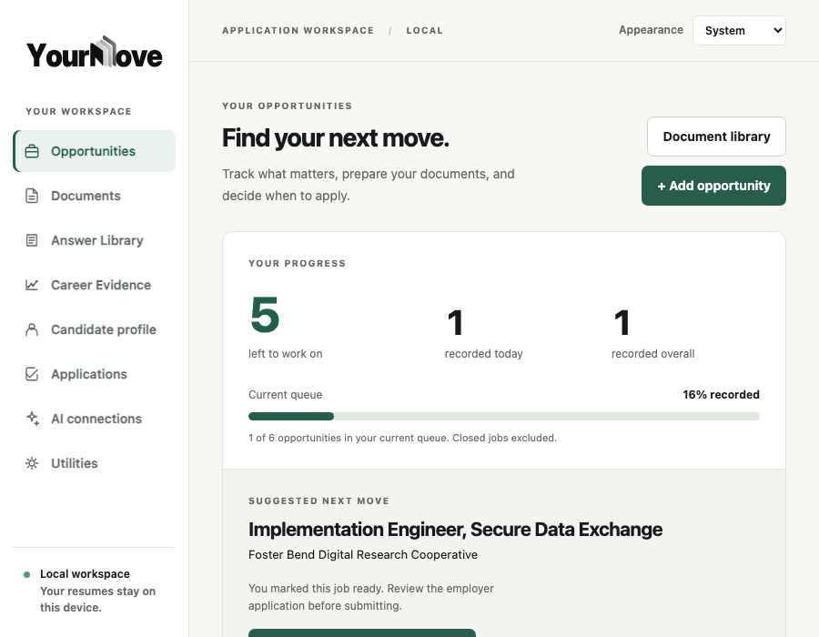
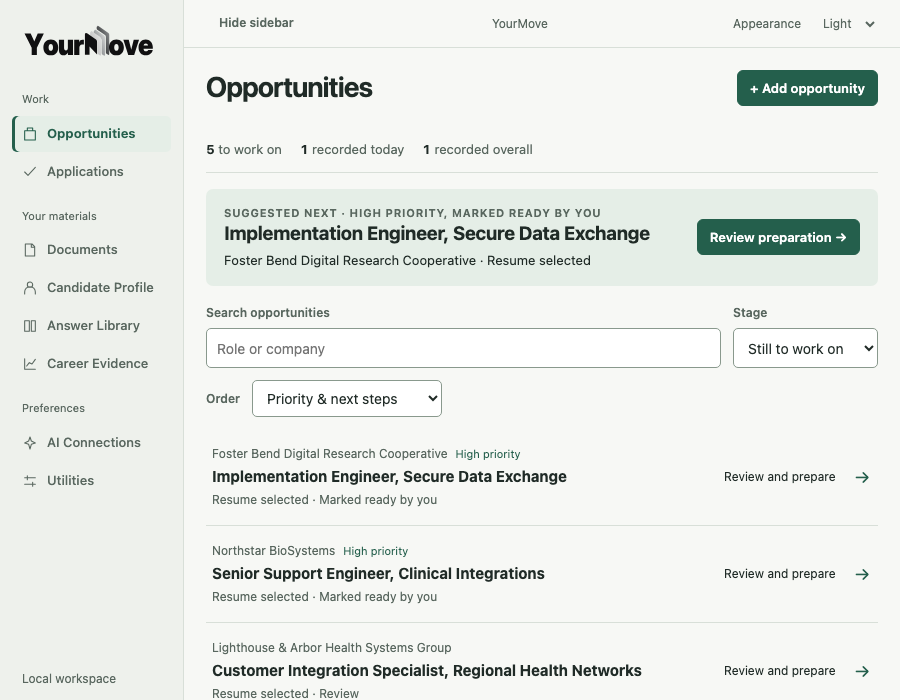
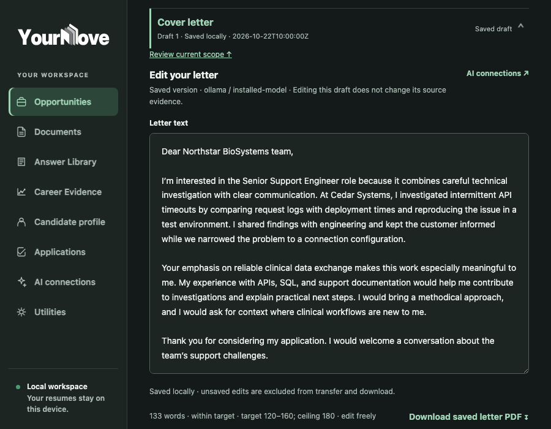
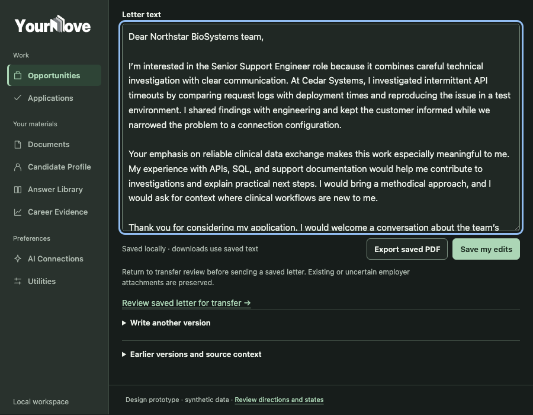

# Rendering evidence and Wails qualification

## What was observed

The connected in-app Browser reported no available browser. Standalone headless Chromium was locally available, and rendered the isolated synthetic prototype. The existing repository templates were served from a temporary SQLite workspace with seven synthetic opportunities, a synthetic PDF, a stored draft, and a local submission record. The baseline server rejects all non-GET requests. No applicant records were read or changed.

Actual Chromium screenshots: Directions A/B/C at 900×700; Answers at 1100×800, 900×700, 750×650, 700×550 (dark); Help at 900×700 light; Overview, Prepare, Cover letter, Documents, Candidate Profile, Answer Library, Career Evidence, AI Connections, History at 1100×800 light; recovery and empty states; typography specimens; comparison board; baseline Opportunities and saved-letter views; proposed saved-letter view. These are web-renderer captures at CSS pixel viewports, not native Wails windows.

`render-log.json` records browser version, routes/viewports, overflow observations, and interactions. In the captured screens, `documentElement.scrollWidth` did not exceed the viewport. This does not prove every offscreen control is visible or accessible. At 700×550 the answer-save controls are below the initial crop and remain reachable by the page's single vertical scroll. The 900×700 comparison shows two complete opportunity rows in Direction A; the baseline screenshot shows none. Both screenshots use the same synthetic job fixture and 900×700 viewport. The scroll-count script excludes hidden rows; positions remain viewport-relative. These observations describe the rendered sample only.

The interaction script exercised the synthetic answer dirty label, explicit in-memory save, source chooser, authorization review, separate not-saved proposal, required confirmation before local history, and routing to history. All five checks passed. The proposal flow makes no request. It is not a production test and cannot validate backend consent, form POSTs, or Wails redirects.

| Same 900×700 saved-letter fixture | Evidence |
|---|---|
| Existing template, dark |  |
| Proposed composition, dark |  |

The baseline screenshot scrolls to the saved editor as the existing page does; the proposed screen opens directly to the same artifact. Both include the same saved synthetic text. The proposed editor measures 780px at 900px content viewport in the rendered layout; the current editor inherits available width. No claim about editing speed or text-entry quality is made.

The recommended heading treatment uses the system font; the study page contains system/Jost text at 12/14/16px, a long actual synthetic employer question, and Jost weights 300/400/500/600/700. Jost's licensed font and OFL notice are local to this prototype. Browser display is not macOS WebKit qualification.

## Native result

The unchanged production Wails binary built and launched with a new empty `YOURMOVE_DATA_DIR` at `/private/tmp/yourmove-astra-native-data`. Its process logged startup at `/jobs`. The available native accessibility inspector did not expose the launched process/window. No native screenshot, click, resize, or WebKit measurement was obtained. Do not treat the Chromium captures or the application’s configured 1100×800 default/700×550 minimum as proof of native layout. The browser window/inspector attempt is outstanding evidence, not a negative Wails usability result.

## Short native acceptance procedure

On macOS, build and launch the approved branch using the existing documented Wails run command (`go run -tags desktop .`) with an empty temporary `YOURMOVE_DATA_DIR`. Never point this procedure at a real workspace. Do not run posting checks, open an employer URL, call a model, or record a real submission.

1. Capture outer window bounds and WebView `innerWidth`/`innerHeight` separately at 1100×800, 900×700, 750×650, and 700×550. Inspect labeled navigation, actual row visibility, wrapped company/title, filter baselines, and page scroll.
2. Inspect light/dark system appearance and explicit appearance control, all focused destinations, VoiceOver names, focus visibility, text zoom, and Escape behavior. Resize through the proposed 820px content breakpoint.
3. Open Overview → Prepare → Answers; type synthetic unsaved text. Switch to Cover letter and back; observe actual dirty warning, retained editor text, question position, scroll/focus restoration, and hash/back behavior. Save only synthetic data, then inspect returned state.
4. Open saved-letter editing, change text, and leave without saving. Confirm existing warning. Use native PDF export Save and Cancel in an isolated workspace; compare file bytes only for synthetic content.
5. Inspect empty and restart states. Confirm browser-only session state is not represented as restored. Recheck the form only on a controlled local fixture; never use a live employer account. Verify separate local submission confirmation and Next behavior only with synthetic values.
6. Check no horizontal overflow, nested scroll traps, clipping, text selection, input/select baselines, reduced motion, and primary action visibility. Quit/relaunch to confirm SQLite records persist while the in-memory browser session does not.

If the external inspector remains unavailable, have the owner perform this short pass and attach the resulting real window captures/measurements before approving the shell. Keep Direction A and threshold provisional until then.

## Reproduce browser captures

From repository root, start a prototype-only server on port 3018 as shown in README. In a second terminal, build/start the GET-only synthetic baseline (`go run docs/implementation/2026-10-22-product-experience/tools/baseline.go`; this uses a temporary database and port 3017). Then run `tools/capture.cjs` with `PLAYWRIGHT_MODULE` set to an installed Playwright package. The checked-in log records the captured renderer version and date; captured PNGs are retained for review. The server exposes only the isolated prototype directory; no repository root serving is required.

The `tools/baseline.go` file is tagged `ignore`; Go runtime tests do not include it. It initializes a fresh temporary SQLite database, inserts only the synthetic fixture, serves the existing handler on loopback, blocks POST, then removes the temporary data at process exit. Keep this strict read-only boundary if editing the tool.
