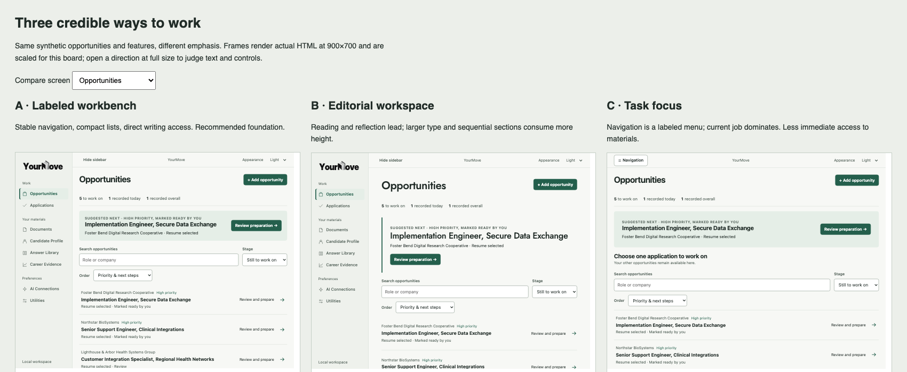

# YourMove — a confident application workbench

**Design investigation, October 22, 2026. Not approved for production.**

Starting local and remote `main`: `add7bd9031fc0d5c466968a0d5f47bcee7d66418` (verified with `git ls-remote`). Exploration branch: `design/astra-product-experience`. Luna source: `46a31d8292887ee158cbdc28f732ab65751b1f00`, read without merging. All changes in this package are isolated documentation, synthetic prototypes, or evidence tools.

## Read this first

**Recommend Direction A, the labeled workbench, with optional focused writing.** YourMove should make it dramatically easier to assemble an accurate application from work the applicant has already done, then continue confidently on the employer website. The strongest differentiation is the relationship between reusable writing, reviewed experience, exact document versions, and deliberate transfer. A tracker alone cannot provide that relationship; opaque autofill cannot provide the same confidence.

The product has stronger engineering semantics than presentation. Local answers, candidate approval, source review, early/live question identity, independent transfer outcomes, and submission confirmation are genuine assets. Several recent improvements already support a serious writing tool. The remaining problem is accumulated presentation: headings and status summaries compete, important activities are below large preparation sections, and secondary tools still resemble independent mini-products.

Do not rewrite the frontend. Recompose the existing server-rendered objects and forms. The full direction needs several increments; the first should visibly improve the shell and Opportunities without changing application authorization.

### Highest-return opportunities

1. **Make the work visible sooner.** Replace the persistent slogan/header/footer framing with a compact labeled shell. At normal desktop sizes, preserve readable destination names.
2. **Give writing a direct entrance.** Answers and Cover letter become direct job-level destinations backed by the existing workbenches. Preserve one authoritative editor and existing return anchors.
3. **Distinguish preparation from transfer.** A separate review surface holds exact saved material and authorization. Its existence must not imply every material is ready or every employer control is supported.
4. **Make Opportunities a working list.** Reduce the large progress panel to one quiet summary and one suggested next action. Preserve counters and progress details; show more real jobs before scrolling.
5. **Make interruptions explainable.** “Saved materials remain; employer browser not restored” is more useful than an ambiguous “Continue.” Surface the current browser owner before opening another job.
6. **Bring assistance to the question.** Keep Help me answer on demand. Distinguish previous wording, reviewed facts, and AI proposals by purpose rather than treating all three as interchangeable sources.
7. **Keep objects ahead of management.** Resume identity and common actions lead; routing, revisions, archive, and deletion follow. Carry this convention into libraries and provider setup.
8. **Improve approval language.** Replace “verified information” with applicant-reviewed language. Neither review nor a successful field observation establishes employer acceptance.
9. **Make optional AI honestly optional.** Setup is contextual and revisitable. Current configuration is external to the app; no in-app key editor or model discovery is implied.

## Package map

| Deliverable | Location |
|---|---|
| A — Executive assessment | This document |
| B — Screen inventory, severity audit, journeys | [AUDIT.md](AUDIT.md) |
| C — Thesis, IA, behavior | [STRATEGY.md](STRATEGY.md) |
| D — Alternatives and scoring | [STRATEGY.md](STRATEGY.md#directions-and-evaluation) and [comparison board](prototype/compare.html) |
| E — Visual language | [DESIGN_SPEC.md](DESIGN_SPEC.md) |
| F — Navigable high-fidelity prototype | [prototype/index.html](prototype/index.html) |
| G — Evidence and Wails qualification | [QUALIFICATION.md](QUALIFICATION.md) |
| H — Incremental implementation | [ROADMAP.md](ROADMAP.md) |
| I — Owner decision brief | Below |



## Preview

From the repository root:

```sh
python3 -m http.server 3018 --bind 127.0.0.1 --directory docs/implementation/2026-10-22-product-experience/prototype
```

Open `http://127.0.0.1:3018/`. Use the footer’s **Review directions and states** link or `compare.html`. Direct examples:

- `index.html#answers` — question editor and Help me answer.
- `index.html?theme=dark#letter` — saved letter.
- `index.html?state=restart#prepare` — recovery.
- `index.html?state=partial#transfer` — uncertain result.
- `index.html?state=empty#opportunities` — first launch.
- `index.html?direction=editorial#opportunities` and `?direction=focus#opportunities` — alternatives.

No production routes, provider calls, storage, or employer browser operations are used. Prototype saves are in memory and reset on reload. Some maintenance controls intentionally open a boundary explanation instead of pretending to execute. This is a design simulation, not the eventual server-rendered implementation. It is not a replacement for real-path testing.

## Owner decisions

Approve a direction, not the whole prototype as a specification for immediate merge.

1. **Labeled workbench with optional focus:** recommend A; retain labels at 900 and 1100 content widths, use a clearly named Navigation menu below 820. Reject the icon rail as the default. Native evaluation can change the threshold.
2. **Direct writing destinations and separate transfer review:** recommend yes, implemented after shell acceptance. Keep Overview / Prepare / Answers / Cover letter / History under one job; the transfer review belongs to Prepare. Preserve the existing form authority and early/live separation.
3. **Typography:** recommend system fonts for operational UI and long writing. Retain the existing wordmark. Keep Jost for optional large introductory or brand use, not as a beta dependency across every heading.
4. **First increment:** approve shell plus Opportunities hierarchy only. Do not include the full job workspace redesign in the same PR.

Approval should lead to one implemented increment, real Wails captures, owner feedback, an accepted merge, and CI verification before the next increment. No production implementation or merge is part of this branch.
