# Iteration 3.2 — Unified Writing Workspace

## Design decision

I chose **two coordinated native disclosures** for Application answers and Cover letter. A compact mode switcher would require a second no-JavaScript path and would make deep-link and browser-history behavior harder to preserve. The disclosures keep existing anchors and forms in the document, work without JavaScript, and natively ensure that only one activity is expanded. A small JavaScript bridge remembers the selected activity and opens it for existing anchors and return URLs.

The answer activity presents the current live or early context chosen by the existing server snapshot. The other context remains reachable in a subordinate recovery disclosure with explicit early/live separation language. No reconciliation or transfer authority was changed.

## User-visible change

Before, Prepare exposed the full early-answer workbench, live-question workbench, and cover-letter studio in one long page. The writing entry points existed, but the workbenches competed for vertical space and made it harder to stay oriented in a normal Wails window.

Now, one **Prepare application materials** area presents the two writing activities together. The selected activity expands in place; the other stays compact. Existing question selection, unsaved text, AI proposals, and saved letter editing remain in their original workbenches. Switching activity is local presentation state and does not submit a form or call a provider.

## Preserved behavior

The existing answer forms, cover-letter generation/edit/save forms, POST handlers, return URLs, question identity and revision checks, dirty-editor protection, provider consent, letter version history, PDF download, and separate transfer authorization remain authoritative. No writing persistence, prompts, employer-browser behavior, or submission flow was changed.

## Visual evidence

Screenshots use synthetic qualification fixtures and are captured at the requested viewport height. The baseline images were captured from `630d9e2cefc73093db8ce481843ed994d13f0147`.

### Before: Prepare workbenches in the long page

| 1100 × 800, dark | 900 × 700, dark |
| --- | --- |
| 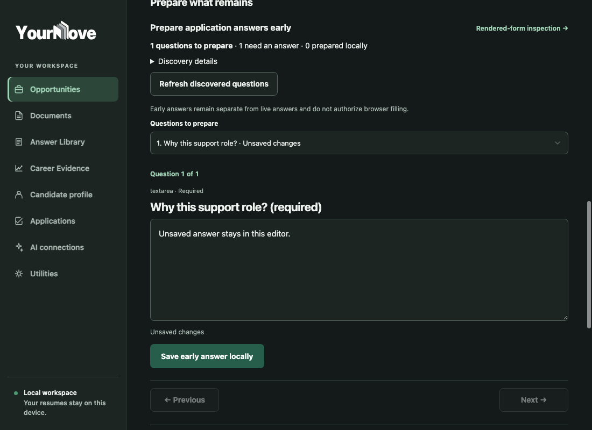 | 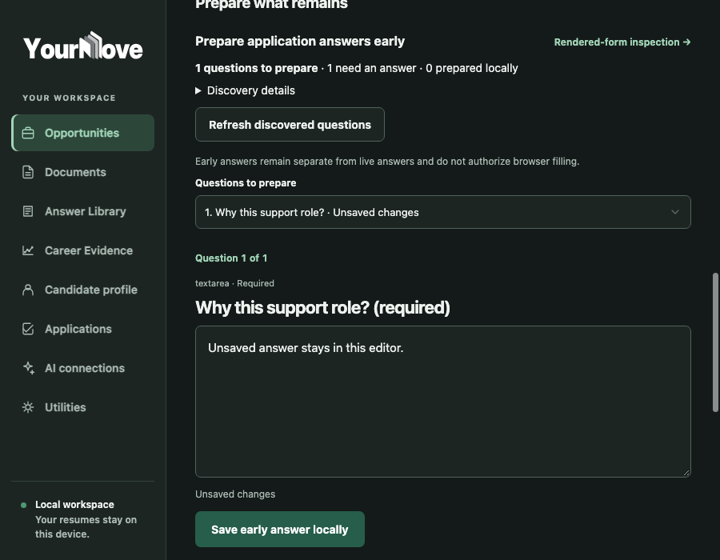 |

| 1100 × 800, dark | 900 × 700, dark |
| --- | --- |
| 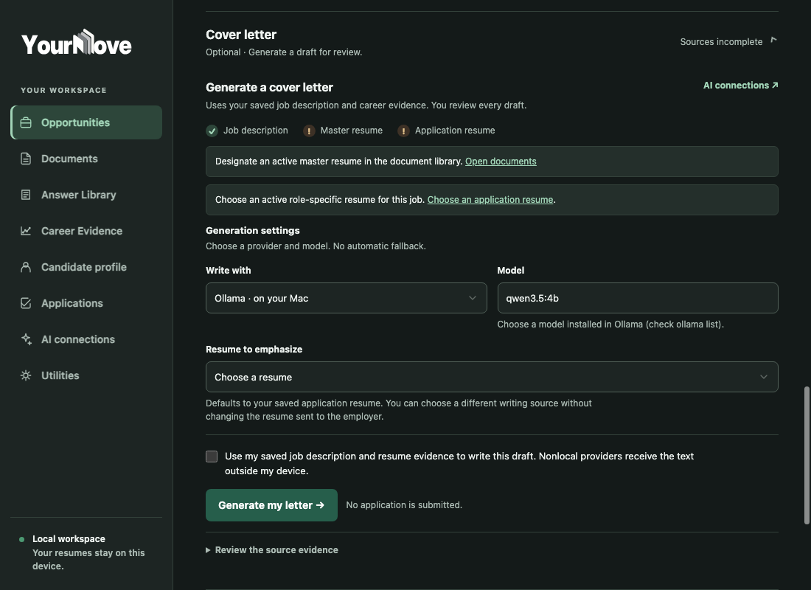 | 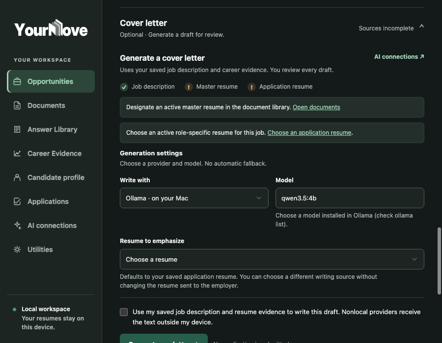 |

### After: selected writing activity

| Answers, 1100 × 800, dark | Answers, 900 × 700, dark |
| --- | --- |
| 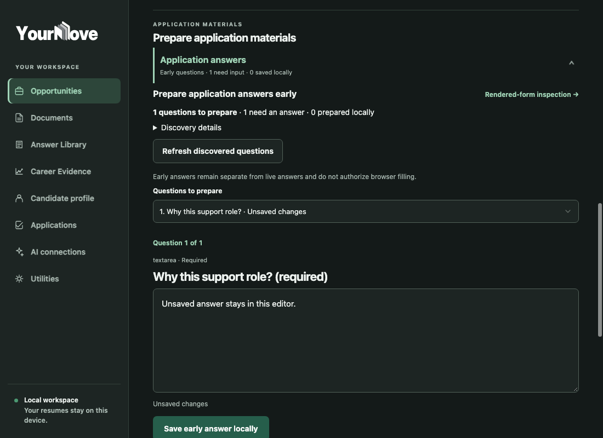 | 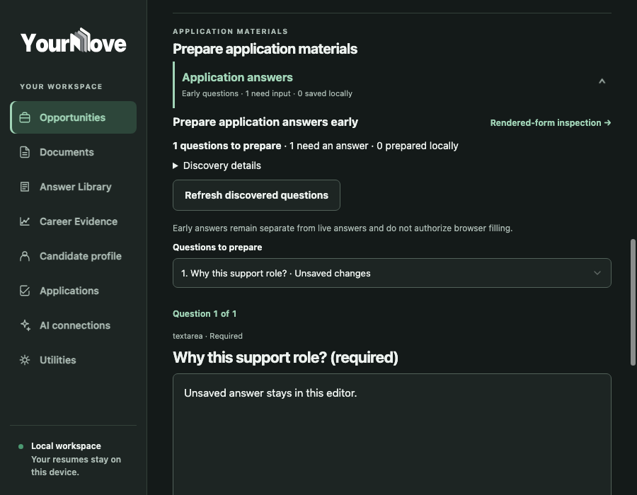 |

| Letter generation, 1100 × 800, dark | Saved letter editor, 900 × 700, dark |
| --- | --- |
|  | 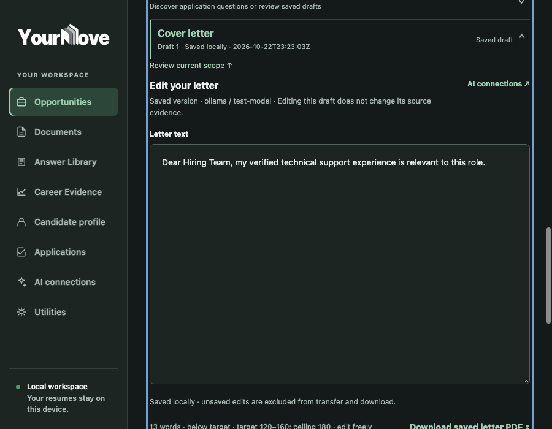 |

| Live answers, 1100 × 800, dark | Live answers, 900 × 700, dark |
| --- | --- |
| 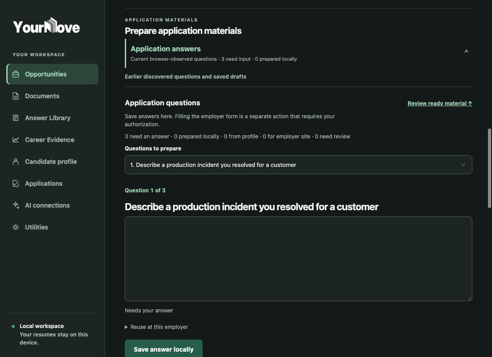 | 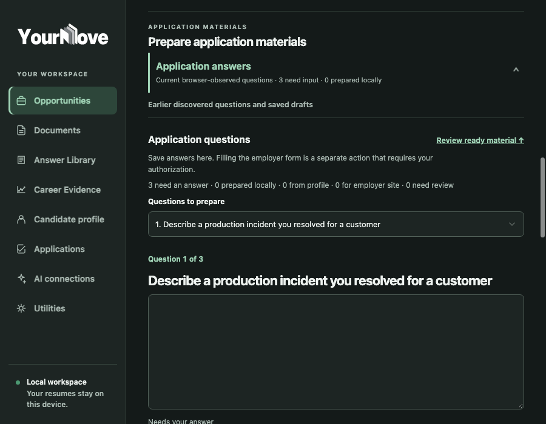 |

| Compact stress test, 750 × 650, dark | Selected activity, 900 × 700, light |
| --- | --- |
| 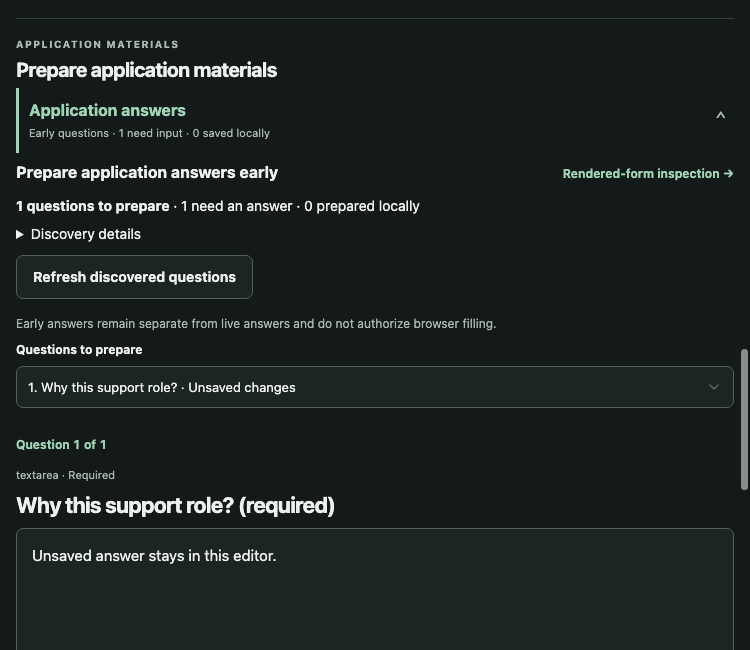 | 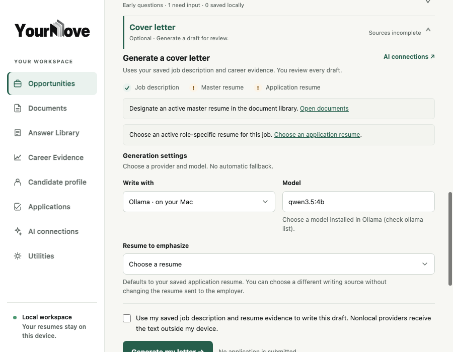 |

| Return to answer context, 900 × 700, light | No JavaScript, 900 × 700, light |
| --- | --- |
| 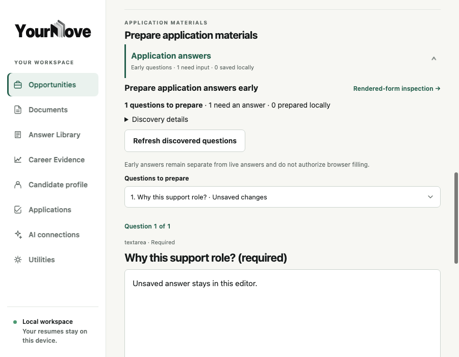 | 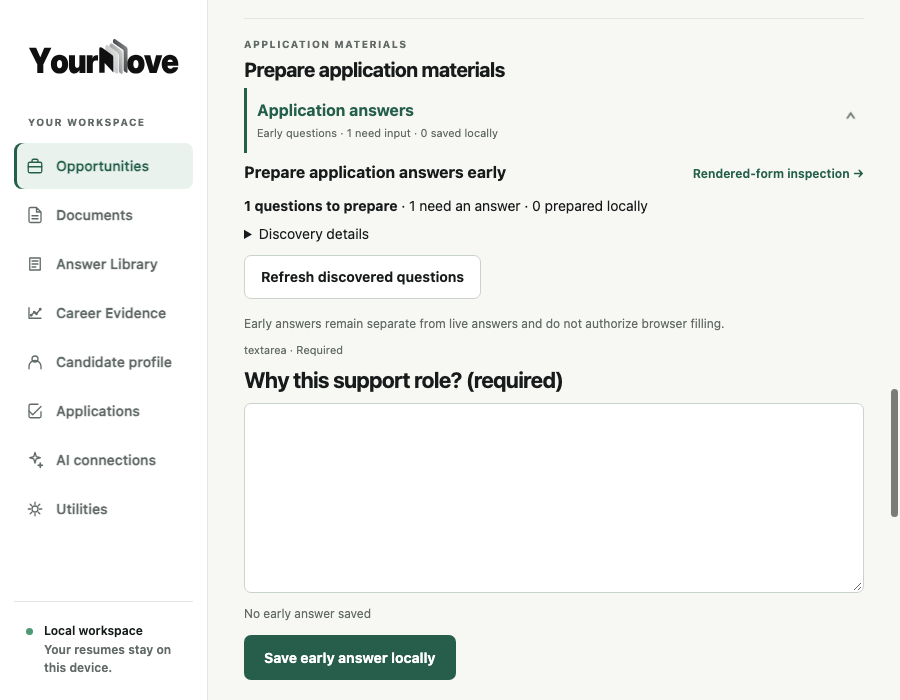 |

## Functional qualification

Controlled Chromium qualification used temporary isolated application data and synthetic jobs, questions, saved answers, letters, and browser observations. No paid AI provider or live employer submission was used.

- Early-only, missing-source, direct answer/letter anchors, entry points, switching, reload, Back/Forward, and no-JavaScript behavior: `TestControlledPrepareEntryPoints` passed.
- Current live answer selection, question-bound AI preview, switch-away/switch-back, and zero additional provider calls while switching: `TestControlledNarrativeAnswerWorkbench` passed.
- Saved-letter editing, unsaved text preservation, save/return scope, download path, light/dark sizes, and no-JavaScript behavior: `TestControlledScopeFirstWorkbench` passed.
- Live question navigation, save, dirty warning, stale/recovery context, and no-JavaScript behavior: `TestControlledQuestionWorkbench` passed.
- Early preparation recovery: `TestControlledEarlyPreparationWorkbench` passed.
- Existing answer and cover-letter tests were retained and the complete Go test suites passed.

`#application-questions`, `#early-application-questions`, and `#letter-editor` remain available. Return URLs for answer saves, letter saves, generation results, and transfer scope reveal the corresponding activity. Browser switching does not change employer fields.

## Performance and complexity

- Latest controlled Prepare response: **35,230 bytes**, **9.57 ms** render time in that qualification run.
- Local activity-switch response: **18.2 ms mean**, **53.9 ms maximum** over the measured interactions; no request is made to reveal an already rendered workbench.
- Help-me-answer retrieval remained on demand: **0 requests before explicit activation** in the measured qualification.
- The change adds 72 lines of UI JavaScript and 30 lines of scoped CSS, with no framework, dependency, persistent state, or new route.

These timings are single-run qualification observations, not performance guarantees.

## Native Wails qualification

Native qualification was attempted with a production desktop build and an isolated `YOURMOVE_DATA_DIR`. The process started, but WebKit tried to write its cache under the user Library directory and sandbox permissions prevented the app window from becoming observable. **The native window was not qualified.** Controlled Chromium is complementary evidence only.

## Manual Wails acceptance (about three minutes)

1. Open a saved job, choose **Prepare**, and select **Application answers**. Confirm the active question and its saved/unsaved status.
2. Type into an answer without saving. Open **Cover letter**, then return to **Application answers**. Confirm the question and typed text remain.
3. Navigate away from the edited answer using a real page link. Confirm the existing dirty-editor warning appears; cancel and verify the text remains.
4. Open **Cover letter**. If a saved draft exists, edit it without saving, switch to answers and back, and confirm the text remains. If no draft exists, inspect the generation prerequisites and confirm missing sources are named.
5. Save one answer and confirm the answer workbench and intended question context are shown on return. If a saved letter is available, open its editor and confirm the draft, version history, and PDF action are present.

## Git handoff

- Feature branch: `ux/wails-writing-workspace`
- Starting `main`: `630d9e2cefc73093db8ce481843ed994d13f0147`
- Merge status: **not merged; awaiting product-owner visual approval**.
