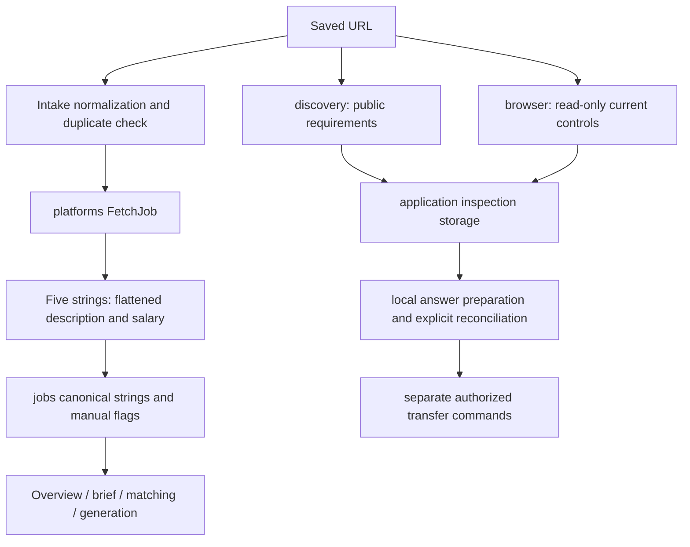
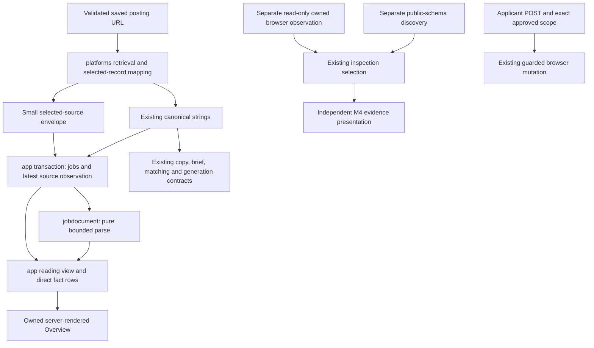
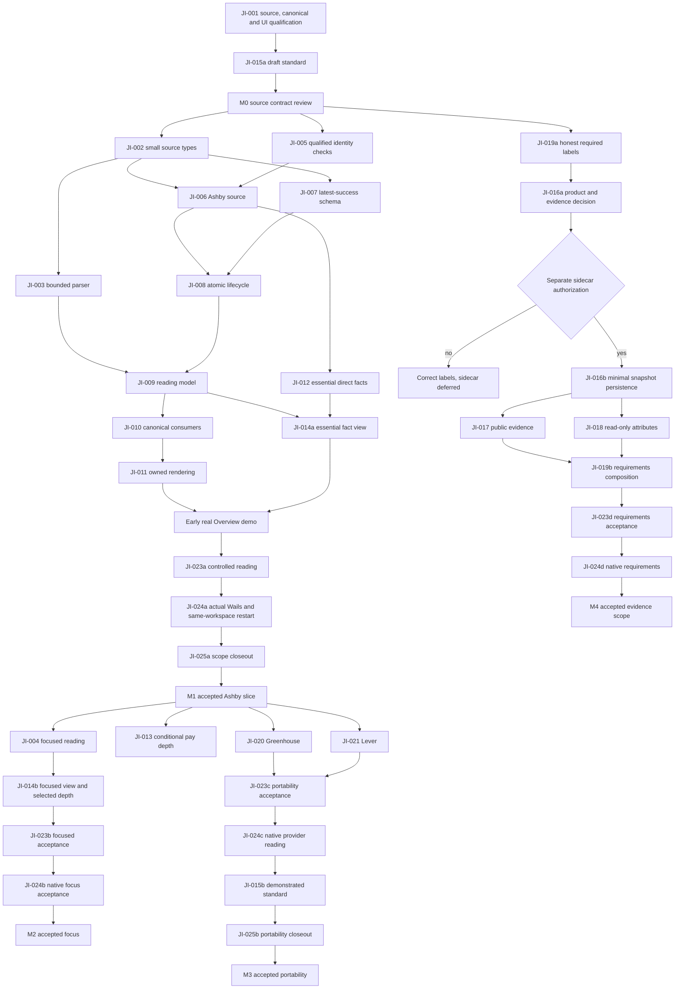

# Job Intelligence: implementation plan

Authoritative implementation reference for the maintainer and Luna. This revision records the M1 implementation and its current closeout evidence. The JI identifiers are an engineering inventory, not 25 sequential approval checkpoints. Execute only a separately authorized capability card, never this entire document.

Revised 2026-10-24 against source `5da7ff214ae1e9ace05d47eed9183d37f7a8c754`, branch `feature/ashby-provider-finalization`, the supplied independent implementation-plan audit and the maintainer's architectural decisions. Those decisions govern where they differ from the audit: focused reading remains a required near-term M2 outcome; provider portability (M3) and requirements evidence (M4) have independent gates. Source spans identify this baseline; revalidate with Graft before implementation. Final M1 maintainer acceptance is recorded in [M1 closeout evidence](evidence/m1-closeout.md#maintainer-acceptance--m1-closeout--2026-10-24).

## A. Current milestone summary and architectural decision

Keep Go, SQLite, server-rendered templates and the existing retrieval, discovery, browser-observation and explicit-mutation owners. Add one small pure `internal/jobdocument` package. Preserve selected employer source beside canonical text; never replace canonical generation or answer identity with rich presentation. No universal Provider interface, adapter registry, semantic taxonomy, extraction service, new browser stack or AI extraction.

| Milestone / gate | Applicant outcome and required scope | Exit / independence |
|---|---|---|
| **M0 — Qualify source and baseline** | Official Ashby contract plus sanitized real-response examples; exact canonical fixtures; current long-posting Overview captures and problem statement; draft onboarding checklist | JI-001 and JI-015a. Positive source shapes qualified before JI-005. Source observations below are evidence toward M0, not completion of its fixtures/UI gate. |
| **M1 — Working Ashby Job Intelligence** | Complete safe rich reading, location/workplace/employment when provided, existing reliable salary, honest freshness, canonical copy/generation, manual precedence, atomic durable source, real Overview and Wails, same-workspace restart | JI-002/003/005–012/014a/023a/024a/025a. Early runnable app demonstration inside this milestone. **No dependency on M2, M3, M4, JI-013 or JI-022.** |
| **M2 — Focused reading and justified depth** | Quickly prioritize responsibilities, qualifications, compensation and hiring instructions; de-emphasize confidently recognized secondary sections; accessible full view retains unknown content. Add deeper facts only for demonstrated need | JI-004/014b/023b/024b after M1. JI-013 is conditional and does not block focused reading. No universal classification/extraction model. |
| **M3 — Portability and demonstrated onboarding** | Working Greenhouse and Lever rich sources through the same application path; actual integrations validate conventions drafted in M0 | JI-020/021/023c/024c/015b/025b after M1. Independent of M2 and M4. Paylocity JI-022 and new-provider research JI-025c are optional, outside this exit. |
| **M4 — Independent requirements evidence** | First remove false optionality claims; then prove a Prepare need before authorizing persisted evidence, collectors and composition | JI-019a/016a after M0; only a separately authorized positive product decision enables JI-016b/017/018/019b/023d/024d. No dependency on M1–M3. A no-go closes the investigation with label correction and a deferred sidecar, not a claim that evidence integration shipped. |

**Current implementation status (2026-10-24): M1 PASS; M2 PARTIAL; M3 PARTIAL; JI-019a PASS.** M1's accepted native evidence and separately unverified details are recorded in [M1 closeout evidence](evidence/m1-closeout.md); VoiceOver announcements remain deferred under YM-017 and do not block M1. M2's conservative section classifier, Overview navigation, full-content fallback, canonical copy, no-JavaScript/keyboard behavior, and controlled Ashby demonstration pass; actual Wails acceptance JI-024b remains NOT VERIFIED. M3 Greenhouse and Lever adapters pass provider, app-lifecycle, provider-refresh-after-manual-edit, restart, and separate controlled Overview demonstrations; official/current public pages were read, but direct live API JSON and native Wails acceptance JI-024c remain NOT VERIFIED. JI-023b and JI-023c are PASS for controlled Chromium scope only. M2 and M3 remain PARTIAL until their independent native gates pass. JI-019a is PASS for truthful labeling with unchanged question identity; no M4 evidence sidecar was built. Source merge and beta/release qualification remain separate decisions governed by `docs/RELEASE_POLICY.md` and `docs/RELEASE_CHECKLIST.md`.

## B. Verified baseline and source qualification

### B1. Repository and evidence limits

Current HEAD and branch match the baseline above. Initial worktree: pre-existing modified `AGENTS.md`, untracked `docs/implementation/job-intelligence/`. Preserve both; this assignment changes only this plan. Remote PR/CI state is **NOT VERIFIED** in this revision; the earlier audit reported a failed GitHub connection. Do not reuse local tracking refs as remote acceptance evidence.

The independent audit reviewed the submitted specification, not a separate checkout. Its source claims are review hypotheses until checked here or during M0. This revision rechecked the provider mapper, refresh SQL, canonical digest, Overview assembly, optionality label and source navigation through Graft. The previous audit's Go test/vet results are historical baseline evidence only; they were not rerun for this documentation change. No new feature tests, controlled browser or Wails acceptance ran here.

Read design constraints: `docs/design/DESIGN_SYSTEM.md` and `docs/design/RULES.md`, especially R1/R6/R8/R9. Existing Phase 2 native limitations and restart instructions are in `docs/implementation/product-experience-implementation/ACCEPTANCE.md` and `docs/BACKLOG.md` (YM-003/008/009/010/016). Their snapshot PR statuses may be stale. They neither qualify this feature nor authorize expansion into release work.

Existing `golang.org/x/net/html`, standard Go concrete structs/functions, SQLite transactions and injectable fetch/client seams suffice. No new dependency or migration framework is required.

### B2. URL-to-consumer trace

| Stage | Exact starting source | Behavior and disposition |
|---|---|---|
| Manual intake | `internal/app/handlers.go:22–114`, `jobForm` | Bounded POST; normalize URL; check duplicates before network; fetch metadata; typed title is manual; save metadata and check status. HTTP GET is presentation only. |
| Normalize/dedupe | `internal/app/intake.go:18–104`, `normalizePostingURL`, `loadURLIndex`, `storeJobIfNew` | Accept absolute HTTP/S for storage, reject credentials/control characters, lowercase host, remove fragments and one ordinary trailing slash, retain query and RawPath. Serialized transactional insertion; old duplicates/malformed rows survive. URL equality is deliberately not a universal ATS identity resolver. |
| Batch intake | `intake.go:124–190`, `importJobBatch` | Up to 50 nonblank lines; one transaction; duplicates reported; no network; new jobs `not_checked`. |
| Posting dispatch | `internal/platforms/platforms.go:15–49`, `Metadata`, `FetchJob` | Five-string metadata result; Ashby/Greenhouse/Lever/Paylocity only. Invalid Ashby UUID is not closure. Greenhouse error-board URL is closure evidence. |
| API network | `internal/platforms/api.go:13–62`, `postingClient`, `getPostingJSONLimited` | Fixed constructed HTTPS hosts, no redirects, 10s timeout; 4 MiB individual responses; Ashby 32 MiB board (`ashby.go:99–115`). 404/410 map to `ErrClosed`. |
| Page retrieval | `internal/platforms/paylocity.go:25–75,136–146` | Only HTTPS `2000recruiting.paylocity.com`, no credentials/port, same allowlist redirects, maximum five, 1 MiB page. Not arbitrary URL HTML retrieval. |
| Ashby wire/mapping | `ashby.go:51–115`, `ashbyBoard`, `extractAshbyMetadata` | Select ID or jobUrl ID fallback, retain title and compensation salary summary; prefer plain over HTML; HTML discarded after fallback conversion. Company is a board-slug suggestion, not verified brand. |
| Greenhouse wire/mapping | `greenhouse.go:45–69`, `greenhouseJob`, `fetchGreenhouse` | Decode only title/content, flatten content; board-slug company suggestion; no direct department/location/pay mapping. |
| Lever wire/mapping | `lever.go:38–130`, `leverPosting`, `fetchLever` | Combined plain description preferred; HTML fallback; opening/body only when combined description empty; append named lists and closing content in order. List titles survive as text, hierarchy/HTML/links do not. Validated salary range display. |
| JSON-LD | `paylocity.go:17–22,77–134`, `jobPosting`, `extractJobMetadata` | Scan ld+json scripts; skip bad JSON, accept first single object whose type is exactly JobPosting; arrays/@graph not supported; only title/description/baseSalary decoded. Organization/location not retained. |
| HTML/text normalization | `description.go:13–81,87–110`, `descriptionText`, `NormalizeDescription` | Up to two entity-unescape passes; tokenize; omit script/style/noscript; block newlines and bullet markers; normalize all inline whitespace; discard blank lines and links. Display normalization only compacts excessive blanks without changing stored source. |
| Compensation | `compensation.go:21–84`, `SalaryFromDescription`, `completeMetadata` | Explicit short pay excerpts only if no structured salary; exclusions for benefits/bonus/equity/etc.; retains regional wording; maximum 500 bytes, abstains rather than truncates. `employer` versus `description` origin only. |
| Job persistence | `internal/app/jobs.go:141–268`, `insertJob`, `jobByID`, `updateJob`, `applyPostingRefresh` | Canonical strings stored; manual flags set on changes; manual salary origin; nonempty retrieved fields replace only nonmanual fields. Failure updates check evidence only. No rich source persisted. Closure changes stage. Do not expand closure/stage policy in this project. |
| Refresh/enrichment | `internal/app/enrichment.go:17–80,242–249`, `postingFetcher`, `refreshPosting` | Existing bounded enrichment, two workers, up to 30 pending/failed active jobs; source check invokes same fetch and refresh. No need for new queue. Missing new salary leaves previous salary retained; missing new description leaves previous description retained. Current source provenance is therefore coarse. |
| DB creation/upgrade | `internal/storage/sqlite.go:11–121,238–377`, `OpenDB`, `initJobsSchema` | One connection; additive table/column initialization, manual flags default conservatively on legacy databases. No new migration framework is justified. |
| Public discovery | `internal/application/discovery/discovery.go:19–65` | Small Inspector/Registry already exists; only Greenhouse advertises public questions. Ashby endpoint resolves destination and explicitly returns partial/uninspected questions. |
| Public questions | `internal/application/providers/greenhouse/greenhouse.go:47–143` | Separate `?questions=true`; names/types/required/options mapped to schema; option labels retained, machine values not modeled; compliance sensitive; demographic payload deliberately not decoded. |
| Live read-only observation | `internal/application/browser/inspect.js:1–110`; `observation.go:14–149`, `AsResult` | Read labels/types/options/required attributes, not values; visible controls, bounded counts; ambiguous identities become unsupported; actions are classified human-only; result `rendered_partial`, conditional/frames/later pages unverified. |
| Ownership | `internal/application/browser/posting.go:43–65`, `OwnsPostingURL` | Exact scheme/host/posting base, Ashby descendant steps, Lever `/apply`; not a generic same-vendor permission. Escaped paths rejected. |
| Snapshot persistence | `internal/app/application_inspections.go:32–83,133–206`, `saveInspection` | Transactional inspection/field/step persistence; fingerprint upsert updates check time; no values. IDs, labels, kind, required bool, sensitivity, group and options retained. No limits/accept/required-unknown dimension. |
| Early preparation/reconciliation | `early_application_answers.go:209–212,325–459,540–616`; `application_answer_reconciliation.go:106–224,269–387` | Store public field snapshot/fingerprint/destination, answer and revision separately; require unique current live match and explicit acceptance; acceptance saves locally, does not fill browser. Old answers remain reviewable. |
| Live answers/profile | `application_answers.go:58–64,194–266`, `questionKey`, `prepareQuestions` | Key hashes destination/provider/whole Field JSON; profile approval and eligibility determine available values; prior unmatched answers retained; schema changes can change identity. |
| Resume/letter/answers transfer | `browser_session.go:18–29,148–211,372–550`; `application_continuation.go:continueApplication`; `cover_letter_transfer.go:46–102`; `application_answer_transfer.go:answerTransferCommand` | Independent guarded operations, hashes/revisions, selected resume, exact destination and explicit scope. New metadata may inform display only. Never create an arm/continue/submit action from extraction. |
| Attachments | `browser/chromium/attachment.go:38–122,195–307` | Separate transient survey knows accept, existing-file and unsafe/parser controls; purpose-qualified file selection protects manual files. Accepted MIME is a hint, not server size/type acceptance. General persisted inspection does not retain it. |
| Session lifecycle | `browser_session.go:344–550`; `application_brief.go:61–99` | In-memory session, close/interruption clears authority; brief uses live only when active and exact latest observation; otherwise one public inventory. No union of stale live and public inventories. |
| Overview | `templates/job.html:8–28`; `jobs.go:83` | Escaped normalized text in `#job-description`, edit textarea uses canonical text. No trusted employer HTML. |
| Clipboard | `static/ui.js:26–38` | Copies `#job-description.innerText.trim()`. Rich/focused rendering would silently change copy unless corrected. |
| Brief | `internal/app/application_brief.go:61–99,248–271,323–328` | Canonical full description export; public/live choice; false required currently labeled Optional. Tests verify full description and exclusion of applicant answers/sensitive content. |
| Generation | `cover_letters.go:124–187,253–356`; `application_answer_ai.go:153–312` | Canonical description SHA-256 for letter evidence, bounded prompt text; local/external explicit consent. Answer generation selected-source snapshots/hashes and revisions. Employer context is not applicant evidence. |
| Matching | `role_families.go:239–333`, `matchResume` | Canonical description token context plus title rules; recommendation only, no silent resume selection. |

Current flow:



### B3. Ashby positive source contract: evidence recorded in this revision

Official primary source: [Ashby Job Postings API](https://developers.ashbyhq.com/docs/public-job-posting-api), markdown metadata updated 2026-10-23, read 2026-10-24. This is the unauthenticated posting-board endpoint, not authenticated `jobPosting.info`, GraphQL, application-schema discovery or an employer form. Do not import guarantees from those other APIs.

Read-only GETs on 2026-10-24 succeeded for [Ashby's public board](https://api.ashbyhq.com/posting-api/job-board/ashby?includeCompensation=true) and [Linear's public board](https://api.ashbyhq.com/posting-api/job-board/linear?includeCompensation=true). No application page was opened, no credentials or applicant information supplied, and no employer form advanced. Full responses stayed in temporary research files, not the repository or proposed source store. Both had root `jobs` and `apiVersion` keys. Raw-response SHA-256 values identify these dated observations, not immutable vendor fixtures:

| Board | Bytes / postings | Response SHA-256 | Observed subset |
|---|---|---|---|
| ashby | 2,199,625 / 67 | `6637679dd94b240a5a33e6b7d0e32739e15d6fc5cedda5fdfd0f608bea506e79` | All had IDs, HTML/plain alternatives, direct location/workplace/employment and per-job compensation; Remote/FullTime in this sample |
| linear | 459,262 / 34 | `d55cac637bd75346f10cf7e58f728c18e5579527387f1e67c87a751d74e7c1e0` | Same field families; 31 Remote and 3 Hybrid; all FullTime in this sample |

Evidence labels below are intentionally distinct. **Source-verified** means the official posting documentation establishes the stated field/meaning, not universal employer population. **Real-response verified** means structural assertions were checked on the public responses and the sanitized projection below. **Documented, not observed** means no matching sample was captured. **Hypothesis** requires additional qualification before changing behavior.

| Contract question | Evidence / conclusion | Implementation consequence |
|---|---|---|
| Board ownership and URLs | Source-verified: board name selects endpoint. Real-response verified: every sampled `jobUrl` used `https://jobs.ashbyhq.com/{requested-board}/{UUID}`; corresponding `applyUrl` appended `/application` | Compare returned URL's board and full posting identity against validated saved URL. A board-slug company suggestion is not a verified brand. No globally required JSON ID. |
| Optional ID | Real-response verified: `id` present in all 101 sampled jobs. The official posting field table/example does not establish it as required | Missing ID plus valid matching `jobUrl` is a required positive fixture. That missing-ID shape is **documented URL-based support, not observed absence**. Contradictory present ID/URL is a negative fixture. |
| HTML/plain alternatives | Source-verified and real-response verified: both fields, nonempty in all samples | Preserve both when distinct; keep existing plain-first canonical selection and HTML fallback. HTML-only/plain-only/empty variants are robustness fixtures, not live observations. |
| Compensation placement | Real-response verified: `jobs[].compensation`; no root compensation in either response | Keep per-job salary-summary mapping. Official table agrees, illustrative example puts compensation at root inconsistently; do not copy that example as an authoritative board-level shape. |
| Location/workplace/employment | Source-verified and real-response verified: `location`, `workplaceType`, `isRemote`, `employmentType`; Remote and Hybrid observed | Direct workplace enum controls display. Broad remote flag alone must not imply fully remote. OnSite and non-FullTime enum variants are documented, not observed in these samples. No eligibility inference. |
| Secondary location/address | Real-response verified: secondary locations occurred in 61/67 and 7/34 jobs; sampled nested address used `address.postalAddress` | Official secondary-address example/table has a shallower shape. M1 retains primary location only. Qualify both address shapes before any M2 mapping; do not design a full address struct now. |
| Published/listed state | Documented semantics; public fields observed, no direct-link-only example qualified | `publishedAt` is republication, not retrieval or content update time. `isListed=false` is not closure. Direct-link-only endpoint behavior and case/alias equivalence remain hypotheses requiring qualification. |
| Missing or conflicting evidence | No live contradictory-ID, wrong-board, nil-description or outage observation was induced | Synthetic negatives protect trust. Reject ambiguous association as retrieval failure, not proof of closure. Never compensate by searching arbitrary endpoints or weakening browser ownership. |

Sanitized selected-job projection from the first Ashby result (public source shape retained; UUID/board and employer prose replaced, irrelevant fields omitted). This is a **sanitized real-response projection**, not a verbatim wire fixture; JI-001 must freeze an attributable, minimal fixture and exact current canonical output before feature code:

```json
{
  "id": "11111111-1111-4111-8111-111111111111",
  "jobUrl": "https://jobs.ashbyhq.com/example/11111111-1111-4111-8111-111111111111",
  "applyUrl": "https://jobs.ashbyhq.com/example/11111111-1111-4111-8111-111111111111/application",
  "title": "[public role title redacted]",
  "descriptionHtml": "<p>[employer prose redacted]</p>",
  "descriptionPlain": "[employer prose redacted]",
  "location": "Remote - European Union",
  "workplaceType": "Remote",
  "isRemote": true,
  "employmentType": "FullTime",
  "compensation": {"scrapeableCompensationSalarySummary": "€150K - €250K"}
}
```

Measured minimal retained-content projections (HTML/plain, the three essential facts and salary summary; UTF-8 JSON, excluding identity/digest/version overhead) were 12,833–48,776 bytes for Ashby and 8,798–16,570 for Linear. Maximum HTML inputs were 26,821 and 9,469 bytes respectively. These samples fit the proposed initial bounds but do not prove optimal limits or worst-case behavior. M0 must measure its final exact serialized envelope.

M0 still owes realistic sanitized HTML structure (not only this redacted paragraph), exact canonical outputs, retained-envelope size measurements and current UI captures. These two boards do not prove all Ashby configurations, missing-ID behavior, links, native operation or closure policy.

### B4. Findings and provider inventory disposition

| Finding / evidence | Correction and gate |
|---|---|
| Ashby discards HTML when plain exists; current Overview is escaped normalized text | JI-006/009/011, M1. Preserve rich source without redefining canonical text. |
| `extractAshbyMetadata` fallback checks host/ID but not board; public Inspector accepts generic HTTPS destination; downstream ownership is stricter | Qualify positive shapes in JI-001 before JI-005. Correct association and destination validation together; no demonstrated exploit asserted. |
| `applyPostingRefresh` retains nonmanual old salary/description if latest success omits them | JI-007/008/014a, M1. Explicit retained-value state without a fabricated historical timestamp. |
| `requiredLabel(false)` returns Optional | JI-019a, independent M4 entry. Fix presentation before considering a sidecar. |
| Changing Field JSON or canonical source can change answer/writing identities | JI-001/010 and M4 compatibility gate. This is a protected regression risk, not observed data loss. |
| Current salary logic is already useful | Keep `completeMetadata`, `SalaryFromDescription`, Lever range validation and JSON-LD salary validation in place. Advanced tiers wait for JI-013. |
| Greenhouse currently flattens content; Lever preserves named list titles only in flattened canonical text | JI-020/021, M3; qualify current official provider shapes when assigned. No need to model their complete inventory in M1. |
| Paylocity supports bounded host-specific single JobPosting JSON-LD, not a general crawler | Preserve existing behavior; JI-022 optional and excluded from every required milestone exit. |

Existing canonical, public-question, browser-observation and mutation behavior is traced in B2. Source availability does not establish host/browser capability. Unknown enum/data stays readable or absent, never inferred from a title, currency symbol or missing form field.

## C. Small data contracts and ownership



`platforms` owns wire decoding and plain source structs; it need not import `jobdocument` merely to express retained inputs. `app` passes description alternatives into the pure parser and composes views. `jobdocument` imports standard library and existing `x/net/html` only: no network, SQL, provider clients, app, discovery, browser or trusted-HTML casts. Storage owns additive DDL; app owns codecs and transactions. No new interfaces are required.

M1's selected source needs: serialization version; validated provider/board/posting identity; one HTML/plain description pair; the associated canonical-description digest; direct location/workplace/employment strings; existing employer salary summary if supplied. Keep private wire booleans only where used to disambiguate missing evidence. Do not add broad PostingDetails, arbitrary metadata maps, normalized fact ontologies, spare optional timestamps, full addresses, team structures, pay components or a universal provenance tuple.

A concrete `PostingSource` with nested identity and a few named fact fields is sufficient. Its identity is validated against the saved posting URL. Saved URL already supplies display base and retrieval identity; do not repeat endpoint, saved URL and application URL in the envelope without a consumer. Apply URL qualification belongs at the destination boundary; no new application authority is stored in a reading source. HTML/plain alternatives preserve demonstrated fidelity; an additional OriginalHTML encoding is deferred. Greenhouse should normally retain its one wire string and decode transiently in JI-020.

| Name | Meaning / stability | Invariant |
|---|---|---|
| **Posting identity** | Validated provider + board + posting key (URL-keyed for optional Paylocity); stable across edits | Association only; never replaced with a content hash, global guessed vendor ID or arbitrary display link |
| **Source-content digest** | Deterministic digest of retained content/facts in source order | Exclude fetch/check times. Define/version its projection explicitly; serialization/digest changes alone do not prove employer content changed. No applicant state or transfer eligibility depends on it. |
| **Canonical-description digest** | SHA-256 of the exact canonical description string associated with the mapped source | Existing generation continues hashing `jobs.description` by existing rules. Parsed output, whitespace comparison and source-format version cannot substitute for it. |

Version the one JSON envelope for decoding, validate on read, and fall back on unknown/corrupt versions. No migration/plugin framework for source versions. Source digest validation may include a projection-version marker, but never show an employer-change warning solely because it changed. Retrieval time is observation metadata in SQL. M1 parser structures start with headings, paragraphs, nested ordered/unordered lists, emphasis and safe links; harmless other text gets an ordered text fallback. Add specialized quote/pre/table models only after a real source demonstrates loss that the fallback cannot address. M3 adds ordered named content parts only when Lever proves the need.

## D. Bounded parsing, display links and canonical compatibility

### D1. Parsing limits

**Before `html.ParseFragment` builds any tree**, validate UTF-8, reject NUL and enforce at most **1 MiB aggregate UTF-8 input bytes** for the selected description alternatives passed to parsing. Separately cap serialized selected-source JSON at **1 MiB** on write/read (HTML + plain + JSON overhead included). Do not rely on a post-parse node count to bound tree allocation.

During traversal bound visited nodes to 20,000, nesting depth to 64, emitted blocks to 10,000 and emitted text/link bytes to 1 MiB. Test exact boundaries and +1. These are **initial defensive choices**, not proven optimums; JI-001 records realistic input/envelope sizes and JI-003 measures representative and near-limit inputs. Change limits only with evidence, not by adding caches/workers. M1 has one description pair; a part-count bound is introduced and qualified with Lever, not required in advance.

Limit/error outcomes produce a complete canonical fallback, never a successful truncated document. Preserve meaningful text from permitted markup in source order; do not claim to reproduce CSS visibility. Omit active/embedded content, employer attributes, event handlers, scripts/styles/templates, images, frames, SVG/MathML and external resources. Preserve harmless wrapper/table text without executing or fetching anything. Malformed HTML may recover; empty meaningful output uses canonical fallback. Never return employer `template.HTML`.

Parse ordinary Ashby HTML directly; entity-escaped literal tags remain text. Keep legacy `descriptionText`/`NormalizeDescription` unchanged for canonical compatibility. Provider-specific Greenhouse decoding belongs in its mapper/input preparation, with fixtures, not a global double-unescape rule. Plain fallback only needs complete escaped paragraphs/line breaks in M1. No classifier dependency.

### D2. One display-link resolution rule

Resolve every relative reference exactly once using Go URL reference resolution against the **validated absolute saved posting URL as stored**, with its query/fragment removed for the base; do not append a slash or substitute `applyUrl`, endpoint, redirected URL or employer `<base>`. Thus `/help` is host-relative and `guide` uses the saved URL's directory semantics. Fragment-only references may become local document anchors only if YourMove generated that target; otherwise retain label text. Ignore employer base tags.

For M1, clickable links must resolve to credential-free HTTPS with default port and the **same exact hostname as the validated saved posting URL**, pass normal hostname/path checks, and contain no control characters or ambiguous encoded separators. Reject scheme-relative foreign targets, lookalikes, unsafe schemes (`javascript`, `data`, `file`, `mailto`, etc.), loopback/private/local destinations, credentials and untrusted hosts; keep their label text. This deliberately conservative display policy leaves unrelated employer/legal domains as text until a concrete, separately reviewed display-host rule is justified. Do not use a wildcard ATS-host allowlist or add source-driven fetches. Test same-host relative links that resolve outside the saved posting path: they can be display links but remain unauthorized for application operations.

A safe display URL grants **no** posting identity, managed-browser ownership, transfer, consent or application-navigation scope. Rendering must use escaped owned template attributes and appropriate external-link protections. The current `/jobs/{id}/open` POST opens the saved posting only; it is not already a generic description-link opener. JI-011 must identify the existing Wails external-navigation mechanism and use or minimally adapt that display-only path without changing posting-open or transfer authorization. Actual native external-link handling and focus return are separate JI-024a acceptance; Go/Chromium results cannot prove them. If safe native handling cannot be demonstrated, report the affected gate NOT VERIFIED and stop rather than loosening trust.

### D3. Canonical consumers and UI alternatives

Canonical description selection stays plain-first (trimmed), then existing HTML fallback; existing salary summary priority and `completeMetadata` remain. Copy uses the exact current `NormalizeDescription(job.Description)` plus legacy clipboard trim, independent of rich/focused markup. A dedicated escaped canonical element supplies copy; clipboard denial/no JavaScript retains selectable text. Brief exports the existing complete stored description and excludes applicant answers/sensitive content. Matching and generation keep canonical strings, exact evidence hashes, consent and current prompt bounds.

One clear rich reading experience leads; secondary native disclosure provides complete canonical/original text. Do not show a prominent Sources differ warning for whitespace, bullets, list numbering, punctuation or ordinary HTML/plain formatting inequality. M1 needs no discrepancy detector. A future material warning requires demonstrated substantial missing or contradictory content, a deterministic explained rule and positive/negative fixtures; absent that evidence, offer the alternative without an alarm. Manual description (including intentional clear) remains primary, employer source secondary and labeled. Unknown source/version/parse failure degrades to canonical rather than breaking the job page.

## E. Source lifecycle, persistence and freshness

Use a small typed rich-source result alongside existing canonical Metadata and retrieval status where it prevents ambiguity: **available**, **unavailable** (bounded reason enum such as absent/too-large/invalid/unsupported), with retrieval failure separate. Optional invalid facts remain absent with scoped diagnostics; they do not make a usable posting a failed retrieval. Do not use one SourceIssue string or nil pointer as the state machine. Existing injection fixtures returning no source adapt to successful canonical-only unavailable; errors remain errors. No generic result framework.

One latest-success observation row per job is sufficient. It holds fetched-at, rich availability/reason, nullable bounded versioned source JSON/digest, and two current confirmation flags: whether **the saved nonmanual description and salary were supplied/confirmed by that successful retrieval**. It is acceptable to use an equivalent small typed persisted state if simpler, but all cases below must be distinguishable after restart. No historical per-field events, guessed original timestamps or retained whole boards. Existing `jobs.source_checked_at/status/note` remains last attempted check. A failed attempt does not update latest-success time.

| New observation | Atomic persistence / display behavior |
|---|---|
| Successful usable rich source | Update allowed nonempty canonical fields under SQL manual predicates; replace source; update latest-success time and current confirmation flags. Rich primary only if identity/canonical association and manual gate pass. |
| Successful canonical-only, absent/too-large/invalid rich source | Update allowed canonical fields and latest-success state; supersede old rich JSON in the same transaction. Never present old HTML as latest source. Preserve explicit unavailability reason and confirmation flags. |
| Failed retrieval, unsupported source or existing affirmative closure outcome | Preserve previous successful source and canonical values; update attempted-check outcome. Label last success separately from failed/closed check. Preserve existing stage/closure policy; malformed identity is not affirmative closure. |
| Successful source omits salary/description | Preserve existing saved values under current SQL behavior; set their confirmation flags false. Show “Saved value; not confirmed by latest source.” **Earlier observation time unknown** unless independently known; never attach new fetch time to that value. Latest direct facts replace old facts, so disappeared location is not current. |
| Manual applicant correction, including clear | Existing manual flags control persistence and primary display. Say manually edited; never assign employer fetch time to correction or replace it with employer rich content. No new reset/override editor. |
| Legacy/no source observation | Canonical still usable; prior observation time unknown. No network/backfill at migration or startup. |

If a latest successful source supplies an unchanged nonmanual value, that can confirm it at that fetch time. If source JSON is unreadable or version/association/digest validation fails, fall back and mark freshness unknown rather than trusting unverified flags. Do not hide SQL errors as source absence.

Create the additive table through `storage.initJobsSchema`; typed codecs/helpers live in app. Manual intake inserts job, source and confirmation state in the existing transaction. Refresh converts canonical update plus source/state write into one transaction; manual predicates are evaluated in SQL, not from a stale Job. Duplicate races retain existing job/source; batch remains offline. Any injected failure rolls back canonical fields, manual flags, source, status and relevant applicant associations together. Explicit job deletion cleans dependent source rows in the existing confirmation transaction; do not assume cascades are enabled or delete independent library data.

No parsed block/fact caches, refresh workers, event bus, field-history table or background migration fetch. Parse once per detail request; no list-row parsing. Record serialized sizes and bounded parse allocations; optimize only an observed problem.

## F. Applicant experience and focused reading

M1 Overview answers “Is this role worth pursuing?” Put readable full description beside a few useful rows: primary location, workplace, employment type when supplied, existing salary and concise source state. Use actual field paths (`jobs[].location`, etc.) in implementation evidence, not a generalized fact record. Direct workplace enum leads; `isRemote=true` alone supports only a broad hint, not fully remote. Keep raw unknown enum wording accessible without inventing normalization or eligibility. Missing critical location may say Not provided; avoid grids of empty metadata cards.

Use existing templates/tokens, bounded prose width, one main reading surface and secondary source/text disclosure. Keep existing Go POSTs, edit/save, Wails redirect adapter, hashes/tabs, document editors, polling/dirty-state behavior and explicit submission confirmation. Preserve no-JavaScript access, keyboard focus and long-word wrapping. Baseline and changed screenshots: ~1280px and 390px browser; actual Wails 700×550 plus a normal desktop window; both appearances. Native viewport, keyboard, clipboard, external opening, VoiceOver/zoom and restart are observed separately.

**M2 focused reading is required near-term, not an optional research backlog.** Use a small deterministic exact heading vocabulary for responsibilities, qualifications, compensation and hiring/application instructions. Semantic HTML headings can be rendered in M1 without classifying them. In M2 a short fully bold heading or plain standalone line is promoted only when an exact tested alias applies; ambiguous labels and other languages abstain. No keyword scoring, free-prose skill/seniority normalization, embeddings or AI.

Recognized priority sections stay easy to reach and prominent; confidently recognized company/benefits/secondary background may use native `<details>` or reduced visual emphasis. Hiring instructions, consequential disclaimers and unknown/ambiguous sections never disappear or become undiscoverable. Supply a complete accessible full view in original order without JavaScript, including every repeated heading, preamble and trailer. Focus must not alter copy or export. JI-023b/024b must demonstrate quick access to the four priority groups on a realistic long posting, no content loss and a workable full-view escape. Do not duplicate large section excerpts alongside the full description or create a generic semantic taxonomy.

M2 deeper facts (department, secondary locations or compensation tier qualifiers) require an observed decision need and qualified source shape. Reuse existing salary owner. Keep tier geography, currency, interval, bonus/equity/commission separate; no conversion, annualization or inferred currency. JI-013 cannot block focused reading and is not a second salary extractor.

## G. Independent requirements-evidence workstream (M4)

The immediate correction JI-019a is presentation only: false/missing legacy Required does not prove optionality. Use “Required state not verified” or, where actual observation supports it, “Not marked required in this observation.” Legacy true may say Recorded required flag. Do not alter Field JSON, Result fingerprint, question keys, saved answers or transfer behavior to repair this label.

JI-016a must demonstrate a concrete Prepare decision improved by additional evidence, compare a label-only solution, and propose the smallest state snapshot before any sidecar storage authorization. Required contract:

- Native required=true establishes an observed browser constraint; absent native required means no native constraint observed, not employer optionality. ARIA false concerns accessibility semantics only. Explicit public false means optional in that published definition, not guaranteed acceptance of an empty live field.
- Preserve required/optional/unknown **per basis**, including explicit native/ARIA conflict. Do not silently choose false over a positive constraint. Public and current live evidence remain separately scoped; no union of stale inventories or global optional conclusion.
- Associate evidence only with the selected exact owned inspection and unique existing field identity. Freeze exact Field JSON, Result fingerprint, questionKey and saved-answer reconciliation fixtures before adding evidence. Sidecar-only changes never change transfer authorization.
- Define observation order independently of content hashes and wall-clock ties. Specify an observation-order token allocated before asynchronous collection and a per-inspection current sequence/pointer checked in the save transaction; reject older completions replacing newer snapshots. JI-016a must define ordering across restart and equal-time observations before storage is authorized. A digest is not a chronological tie-breaker. Same fingerprint can have changing evidence.
- Prefer one latest snapshot if sufficient. If repeated unique states are demonstrably useful, immutable state content plus mutable `first_seen`/`last_seen` and observation sequence is **state tracking**, not an immutable event history. A→B→A must select A's latest observation; preserve first_seen. No event archive without its own use case.
- Capture a strict bounded allowlist of attributes without values, selected/checked state, file names, HTML, cookies or applicant identity. `min/max/pattern/maxlength` are type-specific hints; `accept` does not prove server acceptance or a size limit. No speculative max-file-size field.
- Hidden/ambiguous/custom controls remain unknown under existing collector rules; attachment preflight stays a separate guarded operation. No clicking Next, authentication, consent, cross-origin frame access or mutation. Conditional/later steps remain unknown until user reached and observed.

Only after a separate maintainer product/storage/identity decision can JI-016b add a bounded versioned sidecar outside Field. Preserve existing `chooseApplicationQuestionSnapshot`, one authoritative answer editor, local saves and explicit reconciliation. Evidence cannot authorize attachment/answer/contact transfer, alter identity resolution or create readiness percentages. JI-017 public decoding and JI-018 value-free collector are separate producers within that authorization; JI-019b composes matching fresh evidence. Their controlled/native gates are JI-023d/024d, never JI-023a/024a. No detailed sidecar DDL is frozen before JI-016a answers the product/lifecycle questions.

## H. Provider onboarding standard

Formalize this checklist early in JI-015a; mark code conventions provisional until actual Ashby and then Greenhouse/Lever demonstrate them. Finalize JI-015b using those integrations. Keep `FetchJob` dispatch/concrete Metadata and existing discovery Inspector; no universal Provider, runtime registry, generic vendor client, speculative cache or broad refactor.

| Capability owner | Scope and evidence boundary |
|---|---|
| `internal/platforms` | Validated saved URL → constructed fixed HTTPS endpoint → bounded retrieval → private wire struct → selected canonical/source mapping |
| `internal/application/providers` / discovery | Public application-schema endpoint, only when independently documented/qualified; posting facts are not questions |
| `internal/application/browser` | Read-only value-free live observation under exact saved posting ownership; host/control claims separately qualified |
| Existing chromium/app mutation owners | Applicant POST plus exact approved scope, file hashes/revisions/readback and independent outcomes; no automatic submission |

Each onboarding entry states: user value; exact URL/board/region identity; documented and observed positive shapes; trusted endpoints/timeout/redirect/byte limits; selected wire fields and canonical projection; missing/null/unknown behavior; closure vs outage; safe source fallback; fixtures and negatives; capability-specific evidence and manual fallback. Check returned identity where available, support qualified missing-ID URL fallback, reject contradictions/duplicate ambiguous matches. Never fetch returned apply URLs, source links or arbitrary JSON endpoints.

Use current network seams: fixed HTTPS hosts, no API redirects, cancellation and bounded reads; current limits 32 MiB Ashby board, 4 MiB individual API, 1 MiB Paylocity page. Preserve legacy closure/stage behavior unless a separate source-supported correction is authorized; board 404/direct-link-only ambiguity remains a risk, not permission to infer closure from parsing failure.

M3 independently qualifies Greenhouse encoded content and Lever combined-or-opening/body, native named lists and closing content. Extend source types only for those demonstrated needs; avoid global text deduplication (repetition may be meaningful). Greenhouse can decode its one retained wire encoding transiently; no duplicate OriginalHTML without a proven fidelity distinction. Greenhouse structured pay, public requirements and browser mutation are separate capabilities, not hidden additions to posting work. Lever's salary display/canonical order stay byte-compatible.

Report per capability/provider/host/shape with evidence date, source/artifact identity and limitations: PASS, PARTIAL, UNSUPPORTED, NOT VERIFIED, KNOWN FAILURE. A unit-fixture PASS is not host/native PASS. No universal fully-supported flag. Optional JI-022 preserves only current Paylocity JSON-LD shape; optional JI-025c research (including SmartRecruiters/Workable/Workday/iCIMS) requires a selected opportunity, fresh official sources and a read-only contract. Research never authorizes implementation or mutation.

## I. Milestone dependencies and review boundaries



This diagram shows capability flow; the task index is the exact direct-dependency authority. Milestone gates include their required tasks, so dependencies on M0/M1 mean the full accepted gate, not an exception to it. Optional JI-013, JI-022 and JI-025c are not implicit edges. If pay is selected for JI-014b, JI-013 must pass first. JI-022 requires M1 plus JI-015a and an explicit assignment; JI-025c requires M3 plus a separate research selection.

**Approval grouping:** (1) M0 positive-source/canonical/UI contract; (2) M1 first working demonstration and review of identity/canonical/transaction trust changes, then native completion evidence; (3) M2 focused-reading outcome and any separately selected pay semantics; (4) M3 provider-specific capability results and demonstrated standard; (5) M4 product/identity/privacy/storage decision before sidecar code, then evidence capability acceptance. These are meaningful capability/trust checkpoints, not mandatory stops after each JI ID. Routine parser/template work within the approved card can proceed to its demonstration without repeated approval requests.

One bounded owner-authorized item at a time in a suitable branch. The first M1 card below authorizes only that slice when assigned; it does not auto-chain M2–M4. Do not commit, merge, push, release, change AGENTS.md, use real applicant data or submit applications by implication. During this planning assignment edit only this document. Future implementers update `docs/BACKLOG.md` once per completed capability with IDs, actual commit/PR if any, evidence and deferred scope; keep this plan authoritative and do not create a competing roadmap. Refresh Graft after substantial code changes. Local Graft installation/PATH comes from AGENTS.md/environment, not an architectural requirement.

Provider mapping, pure parsing and schema can be developed independently after the shared M0/JI-002 contract, but lifecycle integration precedes durable claims and canonical copy precedes rich activation. This is dependency guidance, not an instruction to spawn parallel agents or edit shared types concurrently.

## J. First vertical-slice execution card: M1 Ashby reading and essential facts

**Recommended next Luna assignment is M0 qualification (JI-001 + JI-015a), planning/characterization only; then assign this M1 card separately after its entry gate. Do not ask Luna to execute the full plan.**

**Entry:** Revalidate HEAD/status and current PR/CI where available; read AGENTS/design rules; use Graft on exact symbols in B2. M0 has a maintained sanitized realistic sample, positive/negative identity contract, exact canonical/copy/hash fixtures, measured sizes and current Overview screenshots. Record source SHA plus working diff/artifact identity when uncommitted. Maintainer assigns M1 on a suitable isolated branch/workspace; unrelated modifications are preserved.

**Initial scope:** JI-002/003/005/006/007/008/009/010/011/012/014a and reading-only JI-023a/024a/025a. Full HTML headings/paragraphs/lists/emphasis and approved display links; complete canonical copy/text; primary location, workplace, employment, unchanged salary; latest-success/attempted-check/manual/retained states; durable refresh; no advanced facts, classification, new provider, sidecar, collector or transfer change.

**Bounded file set (revalidate symbols before editing):**

- `internal/platforms/platforms.go`, `ashby.go`, new `posting_source.go` and directly related tests/testdata; existing `description.go`/`compensation.go` remain behavior contracts. `internal/application/providers/ashby/ashby.go` and its tests only for qualified response/destination validation in JI-005.
- New `internal/jobdocument/document.go`, `html.go` and focused tests/testdata; minimal plain fallback can stay with these until another file is needed. Do not precreate sections/native-parts/fact frameworks.
- `internal/storage/sqlite.go`; `internal/app/intake.go`, `handlers.go`, `jobs.go`, `enrichment.go`, `application_handlers.go` workspace fields; new `job_posting_sources.go` and `job_reading.go`; existing `deletion.go` transaction owner; directly related app/storage tests. Keep essential fact composition in the reading view unless splitting actually improves navigation.
- `templates/job.html`, `static/styles.css`, scoped canonical copy handler in `static/ui.js`; resource registration only if a template partial needs it. Desktop display-link plumbing only if existing Wails configuration cannot safely open an approved link; identify that mechanism before making a bounded change. Preserve `posting_open.go`, `desktop_redirect.go` and mutation boundaries.
- Existing app qualification test area and synthetic fixture setup for JI-023a/024a; `scripts/qualify-native-workflow.sh` only if its existing test-only fixture wiring demonstrably needs a bounded extension. No new browser stack or production ownership exception. Plan/backlog/evidence updates at capability closeout.

**Contracts to preserve:** B2 and C–H, particularly plain-first canonical selection, existing salary helper precedence, clipboard normalization/trim, stored-description brief export, exact canonical writing digest, Field JSON/fingerprint/question keys, saved answers/draft revisions, manual flags including clear, normalized URL dedupe, offline batch, fixed-host network limits, explicit POST/consent/submission review and Wails redirect semantics. No hash migration or applicant-data rewrite.

**Fixture set:** Real-response-derived long Ashby HTML+plain with location/workplace/employment and existing salary; separate documented/constructed ID-absent matching-jobUrl positive; HTML-only/plain-only and missing optional facts; Remote/Hybrid/unknown workplace; legacy/manual/intentional clear; HTML-only change with unchanged canonical; success omitting prior salary/description; successful unavailable rich source; failed fetch; wrong-board same UUID, conflicting ID/URL, unsafe apply URL, duplicate ambiguous selected records; active HTML, unsafe/relative links and UTF-8/byte/node/depth/output limits. Mark constructed cases as synthetic, not observed host behavior. Use no applicant materials; seed representative saved answers/letter/resume/history from synthetic fixtures only.

**Ordered implementation and demonstration:**

1. Fix the minimum typed source/outcome contract and canonical fixtures (002); implement only qualified identity/destination guards (005). Do not require jobs[].id. Review trust-boundary changes as part of this card, not a new framework.
2. Map selected HTML/plain and three direct role facts with existing canonical/salary projection (006/012). In parallelizable development order, implement pre-parse UTF-8/byte bounds plus the owned minimal parser (003) and additive latest-success storage (007).
3. Connect existing add/refresh/delete transactions and current confirmation state (008), including a rollback assertion before activating source writes. Build manual/association-aware view (009), canonical copy target/compatibility (010), owned Overview and concise facts/freshness (011/014a). No classification prerequisite.
4. **Early runnable app demo, before expanded extraction/types:** through actual production intake and detail handlers, save the sanitized real-format Ashby posting in an isolated workspace using the existing injected posting-fetch fixture seam. Open real Overview, read headings/lists, evaluate location/workplace/salary, copy canonical, edit manually and refresh. No static mockup or parser-only success. Use fixed-host fixture transport, not a production trust bypass. Record what is missing and adjust the small model only for demonstrated loss.
5. Finish meaningful lifecycle/negative assertions: duplicate intake, failure between job/source writes, explicit deletion rollback, successful no-rich and omitted fields, latest-check vs last-success, manual clear, unknown/corrupt source, reopen. Inject failure with a temporary SQLite trigger/helper scoped to the test; do not build a generalized failure-injection system.
6. Verify canonical compatibility with exact canonical strings, copy projection, letter evidence hash, answer identities/reconciliation and synthetic saved artifacts before/after HTML-only refresh. A legitimate canonical change affects future evidence only through current behavior; existing drafts/answers remain reviewable. No AI network call is needed.
7. JI-023a controlled reading through production templates/scripts: desktop/narrow, themes, no JS, clipboard denial/selectable fallback, complete rich/canonical access, safe links, dirty editor preservation, manual/freshness cases, zero transfer/submission actions. Existing guards regress without adding requirements collectors. A fixture browser pass is scoped to the fixture.
8. JI-024a build and launch the actual candidate Wails app with one fresh isolated synthetic `YOURMOVE_DATA_DIR`. Exercise native read → canonical copy → edit/save → refresh, keyboard/disclosure/focus, approved external-link opening/focus return and Wails redirects at 700×550 and a normal window. Quit fully; confirm process exit; relaunch the **same executable with the same existing data directory, without rerunning the seeding script**. Verify rich source, manual corrections, source states, selected documents, saved answers/letter/history and cleared browser authority. No native inference from Go/Chromium; manual owner execution is valid if automation is blocked.
9. Record exact source/diff, bundle/artifact hash, workspace identity, command results, screenshots and observed native steps in the existing evidence conventions; close M1 only with scoped PASS evidence (025a). No release or next-provider action.

**Acceptance:** Safe complete reading and useful facts in the real app; no silent canonical/source partial write; no manual loss; no newer timestamp attached to a retained older value; exact canonical consumers and identities remain compatible; actual Wails clipboard/link/keyboard/save and same-workspace restart observed; zero unauthorized employer actions. Ordinary field absence produces concise honest labels, not warning clutter.

**Stop/review:** Stop at the first runnable demonstration for a capability/trust review, then complete this card's qualification if authorized to continue. Stop sooner for source contract contradictions, canonical/hash/manual/transaction regression, privacy or ownership changes, need for out-of-scope files/features, or after two substantial remediation rounds reveal the source boundary is wrong. Report native harness limitations as NOT VERIFIED; do not add an automation platform to force PASS. Final native gate is a maintainer review of concrete evidence. Never proceed into M2/M3/M4 merely because an ID is next numerically.

## K. Detailed task inventory

The index in O supplies exact direct dependencies and gates. Suffixes split an original ID into independent acceptance scopes; unsuffixed ranges mean the family, never a requirement to complete all suffixes. A task is complete when its scope and evidence pass at the named gate, not merely when code exists. Proposed test labels are illustrative; consolidate tests when their behavioral assertions remain clear. Each task below is independently understandable within its cited contracts; routine completion does not demand its own approval ceremony.

<a id="ji-001"></a>

### JI-001 — Qualify positive Ashby sources, canonical fixtures and current Overview

- **Dependencies / gate:** none. **M0**; evidence applies only to this scope.
- **Starting context:** B2/B3; `extractAshbyMetadata`, `descriptionText`, `completeMetadata`, `DisplayDescription`, refresh SQL and canonical consumers.
- **Affected files:** `internal/platforms/*_test.go`, minimal `testdata/job-intelligence` fixtures, existing app characterization/identity tests where needed, this plan evidence. No production change.
- **Implementation order:** Revalidate source/branch/PR status → compare official posting docs with attributable sanitized real samples → freeze supported URL/ID/destination positives and synthetic negatives → record exact current canonical strings/copy/hash expectations → seed an isolated long-posting job through actual app handlers and capture current Overview at desktop/narrow widths. Measure selected HTML/plain/envelope candidate sizes; record the readability problem and native baseline availability.
- **Acceptance / regression assertions:** Include a documented URL-only identity positive with absent JSON ID, explicitly constructed if not observed; wrong-board/conflicting-ID negatives; real nested descriptions and direct facts. Existing outputs remain unchanged. Fixtures identify source/date/sanitization, distinguish documentation from observation and contain no applicant data. A redacted one-paragraph shape alone does not pass the realistic UI/fixture gate.
- **Verification / evidence:** Run focused current provider/app characterization tests with `-count=1`; record expected strings, SHA, screenshots, sizes and unverified variants. No feature acceptance claimed.
- **Stop / scope boundary:** Stop for M0 source/canonical/UI review with JI-015a. Do not tighten identity or design broad types before the positive contract passes.

<a id="ji-002"></a>

### JI-002 — Define the minimum selected-source and typed availability contracts

- **Dependencies / gate:** M0. **M1**; evidence applies only to this scope.
- **Starting context:** `Metadata` / `FetchJob` in platforms; C/E contract; legacy callers return canonical strings by value.
- **Affected files:** `internal/platforms/platforms.go`, new `posting_source.go` and tests; minimal `internal/jobdocument/document.go` and tests.
- **Implementation order:** Define concrete identity/content/canonical digest names, one HTML/plain pair, three essential direct facts and salary summary. Add available/unavailable rich outcome with bounded reason enum, separate from retrieval error. Define deterministic digest projection, version and size validation; keep source types provider-owned and parser independent.
- **Acceptance / regression assertions:** Nil legacy source adapts explicitly to successful canonical-only unavailable. Missing ID can validate via qualified URL selection. Digest/version/time/identity roles are distinct; unknown versions fail safely. No Endpoint/ApplicationURL/OriginalHTML duplication or speculative Details struct. Exact 1 MiB JSON boundary and invalid UTF-8/NUL cases covered.
- **Verification / evidence:** Focused platforms/jobdocument/app compile/tests and `go list` import check; document a small readable envelope and stable digest examples.
- **Stop / scope boundary:** Type expansion beyond C needs a demonstrated M1 input. Review any trust/compatibility issue within the M1 checkpoint; no automatic separate approval for routine type spelling.

<a id="ji-003"></a>

### JI-003 — Parse bounded Ashby HTML into minimal owned structure

- **Dependencies / gate:** JI-002. **M1**; evidence applies only to this scope.
- **Starting context:** Current `descriptionText` remains canonical owner; existing `x/net/html` supplies fragment parsing.
- **Affected files:** `internal/jobdocument/html.go`, `document.go`, focused tests/testdata; minimal plain fallback only.
- **Implementation order:** Enforce aggregate UTF-8 bytes before tree construction → parse → bounded traversal and output → ordered headings/paragraphs/nested lists/emphasis/safe link data → harmless text fallback. Implement D2 with a validated saved-URL base. Do not classify sections or rewrite canonical text.
- **Acceptance / regression assertions:** Meaningful permitted text survives order; active/embedded markup and employer attributes never reach output. Byte, node, depth, block and output limits fail to complete canonical fallback, not truncation. Test malformed HTML, Unicode, literal encoded tags, relative links, foreign/unsafe targets and exact/+1 bounds; measure representative/near-limit allocations without claiming CSS visibility.
- **Verification / evidence:** `go test -count=1 ./internal/jobdocument`; short bounded fuzz run once the actual target exists; retain size/allocation measurements and expected block projections.
- **Stop / scope boundary:** Add specialized document constructs only for demonstrated content loss. No parser framework, source fetch or template.HTML.

<a id="ji-004"></a>

### JI-004 — Deliver conservative focused reading and accessible full content

- **Dependencies / gate:** M1. **M2**; evidence applies only to this scope.
- **Starting context:** M1 owned document and full Overview; no classifier needed for that working slice. F defines the applicant focus outcome.
- **Affected files:** `internal/jobdocument/sections.go` and focused tests; plain heading helper only if needed; app reading view and `templates/job.html`/scoped CSS.
- **Implementation order:** Recognize a small exact heading vocabulary → prioritize responsibilities/qualifications/compensation/hiring instructions → de-emphasize only confidently recognized secondary material through native disclosure or emphasis → keep a complete no-JS full view. Preserve repeated headings, preamble/trailer and unknown/ambiguous/non-English blocks.
- **Acceptance / regression assertions:** On a realistic long posting each of the four priority groups is easy to reach; unknown content stays available in source order and copy remains canonical. Ambiguous Requirements is never evidence of a form requirement. Classification abstention cannot hide content or break reading.
- **Verification / evidence:** Focused pure and app render tests; positive/abstention/full-content assertions. Controlled JI-023b and actual Wails JI-024b establish interaction acceptance.
- **Stop / scope boundary:** No taxonomy, keyword scoring, AI or generalized extraction. Classification is a near-term M2 deliverable; no dependency from M1 to this task.

**Progress — 2026-10-24: PARTIAL.** `internal/jobdocument.SplitSections` uses exact case-insensitive H2-or-higher heading matches from a short explicit vocabulary; repeated headings, preamble, trailing content, unknown headings, and all source blocks retain order. Pure classifier and parser tests pass. The Overview uses stable native fragment links; unrecognized content remains in the original reading and canonical copy is unchanged. The controlled Ashby demonstration passed each priority link at 700×550, keyboard/no-JS reachability, original-order fallback, and 1280/390 light/dark layouts. Raster captures are retained in the local review archive and excluded from the source PR. Actual Wails acceptance JI-024b remains NOT VERIFIED.

<a id="ji-005"></a>

### JI-005 — Apply source-qualified Ashby identity and destination checks

- **Dependencies / gate:** M0. **M1**; evidence applies only to this scope.
- **Starting context:** `internal/platforms/ashby.go:64–97`; public `Inspector.Inspect` at `internal/application/providers/ashby/ashby.go:66–127`; existing downstream `OwnsPostingURL`.
- **Affected files:** `internal/platforms/ashby.go`/tests and `internal/application/providers/ashby/ashby.go`/tests only; preserve mutation owners.
- **Implementation order:** Use M0 positive shapes → validate saved/requested board plus full posting association → reject contradictory present identifiers/URLs and ambiguous duplicate matches → constrain returned application destination to existing same-posting ownership or saved-posting fallback. Keep ordinary display links separate.
- **Acceptance / regression assertions:** Missing jobs[].id with a matching safe jobUrl succeeds. Present contradictory ID/URL, wrong-board same UUID, credentials/ports/lookalikes/encoded separators and foreign apply targets cannot become trusted association. Valid same-posting /application works. ID-only/no-jobUrl acceptance requires separately documented positive board-context evidence; do not invent a requirement or silently broaden support. Malformed evidence is not closure.
- **Verification / evidence:** Provider URL/selection/destination tests plus existing browser/app ownership tests; accepted/rejected shape table tied to JI-001 evidence.
- **Stop / scope boundary:** Stop if qualified positives fail or employer URL shapes contradict assumptions. Do not fix rich links by loosening browser ownership, redirects or transfer authority.

<a id="ji-006"></a>

### JI-006 — Preserve Ashby selected HTML/plain and existing canonical projection

- **Dependencies / gate:** JI-002, JI-005. **M1**; evidence applies only to this scope.
- **Starting context:** `ashbyBoard`, `extractAshbyMetadata`, `fetchAshby`, `completeMetadata`; canonical plain-first and per-job salary summary.
- **Affected files:** `internal/platforms/ashby.go`, provider/source tests and minimal fixtures.
- **Implementation order:** Decode/select once → preserve selected description alternatives and validated identity → attach exact mapped canonical digest → report rich availability/bounds → keep current title/company/salary/canonical behavior. Reject an unusable blank-title selected record contextually; omitted optional facts do not fail otherwise usable retrieval.
- **Acceptance / regression assertions:** Real-derived HTML/plain round-trip; HTML-only/plain-only/absence/too-large behavior explicit; existing canonical and salary strings unchanged. No full board retained, no application schema inferred, no source-directed request.
- **Verification / evidence:** Focused Ashby/platforms tests plus app seam compile/tests; retain before/after canonical and selected-source examples.
- **Stop / scope boundary:** No expanded facts/compensation/classification. Essential direct facts are JI-012 within the same M1, not a later milestone.

<a id="ji-007"></a>

### JI-007 — Persist one latest-success observation with legacy fallback

- **Dependencies / gate:** JI-002. **M1**; evidence applies only to this scope.
- **Starting context:** `storage.initJobsSchema` in `internal/storage/sqlite.go:32–377`; existing temporary SQLite migration tests.
- **Affected files:** `internal/storage/sqlite.go`, new `internal/app/job_posting_sources.go` and directly related tests.
- **Implementation order:** Add one latest-success source/state table per E → bounded versioned codecs/read helpers → distinguish SQL failure from unavailable/corrupt source → exercise fresh/legacy/repeated OpenDB and reopen. Store only current confirmation flags, not historical field events.
- **Acceptance / regression assertions:** Legacy jobs/answers/resumes/letters/history unchanged; zero network/backfill; absent legacy timestamps stay unknown. Corrupt/future/wrong-identity/hash source falls back without fatal page failure. Canonical-only success can record a latest-success state without old rich JSON.
- **Verification / evidence:** Focused storage/app migration, bounds, association, decode and reopen assertions; compare synthetic record bytes/counts and relevant file hashes.
- **Stop / scope boundary:** No derived cache, event/history tables or source-version migration framework. Only isolated synthetic data directories.

<a id="ji-008"></a>

### JI-008 — Connect atomic intake, refresh and deletion lifecycle

- **Dependencies / gate:** JI-006, JI-007. **M1**; evidence applies only to this scope.
- **Starting context:** `storeJobIfNew`, `jobForm`, `applyPostingRefresh` at `jobs.go:236–268`, `refreshPosting`, existing explicit delete transaction.
- **Affected files:** `internal/app/intake.go`, `handlers.go`, `jobs.go`, `enrichment.go`, `job_posting_sources.go`, existing deletion transaction owner and focused app tests.
- **Implementation order:** Use existing intake transaction → source/state writes → refresh canonical/manual SQL predicates plus source/latest-success in one transaction → successful unavailable supersession vs retrieval failure preservation → explicit source cleanup on confirmed delete. Leave batch import offline and dedupe normalization unchanged.
- **Acceptance / regression assertions:** Temporary-trigger SQL failure leaves old canonical/manual flags/source/status/applicant state unchanged. Duplicate races cannot overwrite existing source. Success omission retains old value unconfirmed; success no-rich cannot reuse old rich; failure retains last success; manual edit/clear wins. Explicit deletion rollback preserves associations.
- **Verification / evidence:** Meaningful transaction tests for intake/refresh/delete, duplicate race, omitted facts/no-rich/failure/manual and same-database reopen; app/storage suites after integration.
- **Stop / scope boundary:** Stop for any partial commit or manual loss; do not expand stage/closure policy, add workers or create a generalized injection framework.

<a id="ji-009"></a>

### JI-009 — Build manual-aware reading and honest freshness states

- **Dependencies / gate:** JI-003, JI-008. **M1**; evidence applies only to this scope.
- **Starting context:** `Job.DisplayDescription`, `jobDetail` at `handlers.go:116–309`, `jobWorkspace` in application_handlers.go, source read helper.
- **Affected files:** New `internal/app/job_reading.go`/tests; existing detail/workspace assembly fields.
- **Implementation order:** Load validated latest observation → pure manual/identity/canonical association decision → parse once or canonical fallback → explicit latest-success/attempt/failure/retained/manual view states. Preserve full canonical projection independently from document blocks.
- **Acceptance / regression assertions:** Manual clear never replaced visually; matching source renders rich; mismatched/corrupt/empty/limit source falls back. Retained salary/description never receives newest source time; failed check does not reset last-success time. No automatic fetch on detail/list/startup.
- **Verification / evidence:** Table-driven authority/fallback/freshness tests; exact stored canonical and hashes before/after view construction.
- **Stop / scope boundary:** No classification or metadata reconciliation framework. Ordinary HTML/plain text inequality does not become a warning.

<a id="ji-010"></a>

### JI-010 — Preserve canonical copy, export, generation and saved identities

- **Dependencies / gate:** JI-009. **M1**; evidence applies only to this scope.
- **Starting context:** `static/ui.js:26–38` copies current text DOM; B2 consumers include letterEvidenceForJob, questionKey, brief and matching.
- **Affected files:** Scoped copy handler in `static/ui.js`, dedicated escaped canonical target in `templates/job.html`, current consumer/identity regression tests only.
- **Implementation order:** Supply canonical target before rich activation → retain normalized/trimmed clipboard policy and denial fallback → assert full stored-description brief, matching/generation source selection and exact identity compatibility → compare saved synthetic artifacts after HTML-only refresh.
- **Acceptance / regression assertions:** Rich structure/parser/source-version changes with unchanged canonical do not change letter description hash, Field JSON/fingerprint/question keys or existing saved answer/letter revisions. Legitimate canonical changes retain old artifacts and affect only future evidence by existing behavior. No applicant answers/sensitive data added to brief.
- **Verification / evidence:** Focused copy DOM/consumer tests and exact hash/reconciliation fixtures; controlled clipboard/no-JS evidence in JI-023a. Tests need no live generation or AI consent.
- **Stop / scope boundary:** Stop for canonical identity drift; do not update old hash expectations to match new rich text.

<a id="ji-011"></a>

### JI-011 — Render one safe complete Overview and display-only links

- **Dependencies / gate:** JI-010. **M1**; evidence applies only to this scope.
- **Starting context:** `templates/job.html:8–28`, existing styles/resources and D/F contracts; current posting-open route handles saved URL only.
- **Affected files:** `templates/job.html`, scoped `static/styles.css`, resource partial registration if necessary, render tests; smallest actual desktop display-link mechanism if needed.
- **Implementation order:** Capture current screen → render owned document markup and complete canonical disclosure → apply readable measure/list/link wrapping → preserve editor/form/tab IDs and no-JS access → identify safe Wails external opening without abusing posting-open or browser authorization.
- **Acceptance / regression assertions:** Complete content/order and unknown headings accessible; scripts/event handlers/unsafe URLs never reach executable output. No duplicate reading dashboard/warning noise. Canonical text selectable if clipboard fails; forms and Wails redirects preserved. Same-host safe display links confer no application ownership even outside posting path.
- **Verification / evidence:** Template/render, existing handler/redirect regressions and scoped JS syntax check; actual responsive/keyboard/link behavior through JI-023a/024a.
- **Stop / scope boundary:** No raw employer HTML, broad host rule, frontend framework, Prepare redesign or classification prerequisite. Native link behavior must be demonstrated, not assumed.

<a id="ji-012"></a>

### JI-012 — Map the three essential direct Ashby role facts

- **Dependencies / gate:** JI-006. **M1**; evidence applies only to this scope.
- **Starting context:** B3 real-response fields `location`, `workplaceType`, `employmentType`; `isRemote` documents a broader hint.
- **Affected files:** `internal/platforms/ashby.go` private wire/mapping, minimal source fields and provider tests.
- **Implementation order:** Map primary location, explicit workplace and employment strings only → normalize known display values conservatively at view boundary → preserve unknown wording/absence → tie mapping tests to exact field paths. Pointer boolean only if the broad hint is actually displayed.
- **Acceptance / regression assertions:** Remote/Hybrid/OnSite and missing/unknown variants honest; isRemote=true never independently asserts fully remote or geographic eligibility. No department/address/timestamp/pay-tier struct needed. Canonical description/salary unchanged.
- **Verification / evidence:** Focused mapper/round-trip tests using real-derived and labeled synthetic enum/absence/conflict cases; essential fact UI qualified by JI-014a/023a/024a.
- **Stop / scope boundary:** Do not defer location/workplace behind advanced salary or M2. Deeper direct fields need demonstrated value and a separate M2 selection.

<a id="ji-013"></a>

### JI-013 — Preserve justified compensation qualifiers without a new extractor

- **Dependencies / gate:** M1; explicit deeper-pay selection. **M2 optional depth**; evidence applies only to this scope.
- **Starting context:** Existing compensation helpers and qualified per-job Ashby compensation in B3. F requires an observed pay-decision gap.
- **Affected files:** Only needed Ashby private wire/source fields, existing compensation tests and selected fact-view tests. No generic salary package.
- **Implementation order:** Document a concrete misleading/lost qualifier case → capture minimal tiers/components → preserve geography/type/currency/interval/null semantics → reuse existing salary priority and exclusions → add qualified secondary display only for selected need.
- **Acceptance / regression assertions:** No cross-tier max/min merging, currency inference, annualization, equity-as-base-pay, bonus-null-as-zero or benefits promotion. Manual salary remains primary and legacy SalaryText/SalaryOrigin expectations pass. Invalid optional components abstain without failing posting.
- **Verification / evidence:** Focused salary/provider and app precedence tests; positive/negative qualifier examples. If selected into JI-014b, include those examples in JI-023b/024b.
- **Stop / scope boundary:** Conditional, outside required M2 focus exit. Stop if no product need or only speculative source shape; do not introduce a second extractor.

<a id="ji-014a"></a>

### JI-014a — Compose essential facts and current-value provenance

- **Dependencies / gate:** JI-009, JI-012. **M1**; evidence applies only to this scope.
- **Starting context:** Existing Job manual salary/title/company flags and Overview; C/E/F minimal source/read model.
- **Affected files:** `internal/app/job_reading.go` or a small fact helper if warranted, workspace/template/scoped CSS and focused tests.
- **Implementation order:** Display primary location/workplace/employment with existing salary → show concise source/manual/retained state → omit decorative unknown rows, with a useful Not provided label for missing critical location → keep full source/text secondary.
- **Acceptance / regression assertions:** Manual salary/title/company lead; current direct facts never inferred from prose. Old salary omitted by new success is marked unconfirmed without new timestamp. No tier/excerpt dependency, duplicates, arbitrary confidence score or empty-card grid.
- **Verification / evidence:** Field-specific precedence/freshness/render tests and early real Overview demonstration; JI-023a/024a gate the actual experience.
- **Stop / scope boundary:** Essential facts are part of the initial product slice. No requirement sidecar, classifier or JI-013 dependency.

<a id="ji-014b"></a>

### JI-014b — Compose focused reading and only selected deeper facts

- **Dependencies / gate:** JI-004; JI-013 only if pay selected. **M2**; evidence applies only to this scope.
- **Starting context:** M1 fact/reading view plus JI-004 heading ranges; observed limitations from the first runnable slice.
- **Affected files:** Existing app reading/fact helper, `templates/job.html`, scoped CSS/tests; provider/source fields only for justified direct detail.
- **Implementation order:** Integrate focus affordances with current facts → choose any deeper department/secondary-location/pay qualifier only from observed need and qualified sample → avoid repeating full sections or replacing existing salary/canonical evidence.
- **Acceptance / regression assertions:** Four priority reading groups work with complete unknown/full content; secondary material de-emphasized conservatively; every selected deeper fact traceable to a direct field or verbatim section. Address shape discrepancies in B3 qualified before mapping. No fact ontology/contact/skill extraction.
- **Verification / evidence:** Focused authority/abstention/render tests; JI-023b/024b full-content/copy/native focus acceptance. Record selected and deferred depth explicitly.
- **Stop / scope boundary:** Required focus can close without JI-013 or other new facts. Do not make absent optional depth a hidden acceptance blocker.

**Progress — 2026-10-24: PARTIAL.** The focused reading model composes section links over the existing document and does not add or duplicate content. No optional pay-depth change was selected; JI-013 remains nonblocking. Controlled browser/copy/full-source assertions pass; actual native interaction and same-workspace restart for this focused-reading candidate remain NOT VERIFIED under JI-024b.

<a id="ji-015a"></a>

### JI-015a — Draft the provider onboarding playbook from actual boundaries

- **Dependencies / gate:** JI-001. **M0**; evidence applies only to this scope.
- **Starting context:** H, existing `FetchJob`/posting client seams, discovery Inspector and integration notes.
- **Affected files:** Existing `docs/implementation/ats-platform-integration-notes.md` and this plan evidence during future assignment; no production code.
- **Implementation order:** Write one reusable entry/checklist for source identity/endpoints/fields/canonical limits/errors/fixtures/fallback and separate capabilities. Fill Ashby observed-vs-documented evidence; mark unproven conventions provisional.
- **Acceptance / regression assertions:** A posting-only provider does not need public questions, browser observation or mutation. No universal Provider/registry/support flag or code-move mandate. Clear evidence scope and future Greenhouse/Lever validation step.
- **Verification / evidence:** Graft-backed symbol/path and document consistency review; no Go tests for prose-only work.
- **Stop / scope boundary:** M0 contract review with JI-001. The playbook can be drafted early; code conventions are finalized only by JI-015b.

<a id="ji-015b"></a>

### JI-015b — Validate and finalize conventions through working portability

- **Dependencies / gate:** JI-024c. **M3**; evidence applies only to this scope.
- **Starting context:** Actual M1 Ashby and M3 Greenhouse/Lever implementations and exact evidence; draft H/JI-015a.
- **Affected files:** Existing integration notes and this plan capability/evidence entries; no abstraction refactor by default.
- **Implementation order:** Walk URL→fetch→mapping→source→transaction→parser→Overview for all three → revise checklist from concrete differences → record host/capability limitations and tiny demonstrated shared helpers, if any.
- **Acceptance / regression assertions:** Worked onboarding example reflects real code and both portability gates; no full-support claim or forced changes to unrelated mappers. New provider entry is understandable without implementing form capabilities.
- **Verification / evidence:** Source/path/import/fixture walkthrough and documentation consistency; reuse valid exact-candidate test evidence rather than rerunning solely for prose.
- **Stop / scope boundary:** Do not extract a framework because the checklist looks repetitive. Final scope closeout is JI-025b.

**Progress — 2026-10-24: PARTIAL.** The existing onboarding notes now compare all three provider adapters against the concrete URL→fetch→mapping→source→transaction→parser→Overview path and record provider-specific fields, limits, official documentation, synthetic fixtures, current public page observations, and unverified direct API bodies. The shared region field is limited to Lever. Controlled provider evidence passes; actual Wails JI-024c remains NOT VERIFIED, so finalization stays with JI-025b.

<a id="ji-016a"></a>

### JI-016a — Prove the requirements product need and evidence contract

- **Dependencies / gate:** JI-019a. **M4 decision**; evidence applies only to this scope.
- **Starting context:** G; actual Prepare question selection; legacy Field/Result/questionKey and saved-answer reconciliation.
- **Affected files:** This plan requirements evidence decision and existing integration/evidence notes; current test fixtures only for characterization if needed. No sidecar DDL/collector feature.
- **Implementation order:** Compare label-only behavior with a concrete Prepare need → specify per-basis required/optional/unknown/conflict, safe type-specific attributes, exact field identity and source snapshot selection → choose latest-state vs justified first/last-seen tracking and monotonic observation ordering → present a minimal bounded persistence proposal.
- **Acceptance / regression assertions:** Native true/ARIA false conflict and public false/live unknown examples explicit; absence never global optional. A→B→A and equal-time/out-of-order completion cases defined without digest ordering. Exact old identities and zero changed transfer authority demonstrated. Product need and maintenance cost support a recorded go/no-go.
- **Verification / evidence:** Concrete workflow example, identity characterization comparisons and reviewed lifecycle/privacy contract. A no-go defers JI-016b–019b,023d,024d explicitly.
- **Stop / scope boundary:** This is an explicit independent product/storage/identity authorization boundary before any sidecar implementation; do not infer approval from reading work.

<a id="ji-016b"></a>

### JI-016b — Implement only the authorized minimal requirement snapshot sidecar

- **Dependencies / gate:** JI-016a; explicit sidecar authorization. **M4 evidence**; evidence applies only to this scope.
- **Starting context:** Approved G/JI-016a contract; `saveInspection` transaction and additive storage initializer.
- **Affected files:** `internal/application/schema` data-only evidence outside Field; storage DDL; app requirement codec/persistence helpers and inspection transaction tests.
- **Implementation order:** Freeze exact identities → add bounded separate evidence snapshot/digest → save with observation sequence/current selection atomically → read matching snapshot/fallback → explicit deletion/legacy/reopen behavior. Use first_seen/last_seen only if the approved need requires repeated state tracking.
- **Acceptance / regression assertions:** Same fields retain exact Field JSON, Result fingerprint and question keys; saved answers/reconciliation/transfer eligibility unchanged. Evidence-only changes do not require key migration. Sequence chooses recency, including A→B→A and equal timestamps; stale completions cannot win. Corrupt evidence yields unknown; SQL failure rolls back.
- **Verification / evidence:** Meaningful bounded identity/ordering/rollback/legacy/reopen tests in schema/storage/app; no event-history claim if last-seen is mutable.
- **Stop / scope boundary:** Do not implement speculative MaxFileBytes, all constraints, immutable events or persistence beyond the approved decision. No applicant values/selectors/authority.

<a id="ji-017"></a>

### JI-017 — Record explicit public requirement presence separately

- **Dependencies / gate:** JI-016b. **M4 evidence**; evidence applies only to this scope.
- **Starting context:** Existing Greenhouse Inspector public question decoder and schema result; G per-basis semantics.
- **Affected files:** `internal/application/providers/greenhouse` wire mapper/tests and sidecar integration tests only.
- **Implementation order:** Decode required presence with *bool → emit explicit public required/optional/unknown evidence → retain exact legacy Field projection and field options. Map other hints only with documented attributable fields and a selected use case.
- **Acceptance / regression assertions:** Absent/null differs from explicit false; false means optional in published definition only. No live completeness or later-step guarantee; no Ashby questions invented; sensitive compliance handling stays manual. Old question identity and reconciliation remain stable.
- **Verification / evidence:** Presence/type/duplicate-ID/privacy cases and exact old/new Field/key tests; public persistence join tests.
- **Stop / scope boundary:** No employer requests beyond qualified read-only public source; no discovery framework or browser collector coupling.

<a id="ji-018"></a>

### JI-018 — Observe authorized safe native attributes without values or actions

- **Dependencies / gate:** JI-016b. **M4 evidence**; evidence applies only to this scope.
- **Starting context:** Existing `browser/inspect.js`, observation normalization/AsResult and identity; attachment survey remains separate.
- **Affected files:** `internal/application/browser/inspect.js`, observation types/tests and existing controlled fixture area; no mutation commands.
- **Implementation order:** Collect only approved bounded attribute allowlist for unique visible supported controls → retain native/ARIA bases and conflict → normalize separate evidence without changing legacy Field identity → assert no values/actions/network/navigation.
- **Acceptance / regression assertions:** Absent native required stays unknown globally; ARIA false cannot override native true or promise employer optionality. Type-specific min/max/pattern hints scoped; no values/checked state/chosen files/HTML. Hidden/ambiguous/conditional controls follow existing exclusions and user-reached-state limits.
- **Verification / evidence:** Static value-access review, exact legacy identity assertions, controlled native/custom/group fixtures with zero-action/request counters; later JI-023d handles composition.
- **Stop / scope boundary:** No attachment preflight reuse, clicking Next, cross-origin inspection, consent/authentication or source-driven mutation. Stop for identity or privacy drift.

<a id="ji-019a"></a>

### JI-019a — Correct false optionality labels before additional evidence machinery

- **Dependencies / gate:** M0. **M4 label correction**; evidence applies only to this scope.
- **Starting context:** `requiredLabel` at `application_brief.go:323–328` and presentation call sites; current Required bool lacks presence/basis.
- **Affected files:** Existing app brief/requirements label helpers, relevant template copy and focused presentation tests only.
- **Implementation order:** Change false legacy required presentation to Required state not verified (or a more scoped observed statement when proven); preserve true as recorded required evidence. Reuse existing selected inventory and editors.
- **Acceptance / regression assertions:** No legacy false becomes global Optional. Canonical descriptions, Field JSON/fingerprint/question keys, saved answers, transfer validators and public/live inventory selection remain unchanged. Label fix needs no sidecar, collector or provider expansion.
- **Verification / evidence:** Focused label/brief render assertions and exact identity invariance. Review synthetic actual Prepare/brief; it can ship independently of M1 and sidecar.
- **Stop / scope boundary:** Keep this immediate change bounded. A more detailed label cannot imply server acceptance or evidence that was never stored.

**Progress — 2026-10-24: PASS.** `requiredLabel(false)` now says `Required state not verified`; true remains `Required`. Brief and focused tests pass, including unchanged field JSON, schema fingerprint, question key, saved-answer behavior, and transfer approval. No sidecar, collector, or schema-discovery change was made.

<a id="ji-019b"></a>

### JI-019b — Compose source-scoped requirement evidence in existing Prepare

- **Dependencies / gate:** JI-017, JI-018. **M4 evidence**; evidence applies only to this scope.
- **Starting context:** `chooseApplicationQuestionSnapshot`, existing Prepare/brief and authorized sidecar lookup; JI-019a honest fallback.
- **Affected files:** App requirement/brief view helper, relevant `templates/job.html`/`inspection.html` presentation and focused tests only.
- **Implementation order:** Select one authoritative current owned inventory → match sidecar identity and latest eligible observation → show source-scoped states/conflicts/type-specific hints → retain manual editor and draft access. Keep public reference separately labeled.
- **Acceptance / regression assertions:** No stale/foreign join, global optionality, union counts/readiness score or second answer editor. Restart clears browser authority; saved evidence remains historical context only. No sensitive values in brief or evidence; question definitions never treated as applicant answers.
- **Verification / evidence:** Active/public/stale/restart/out-of-order/conflict/legacy table tests; JI-023d/024d establish actual requirements UX independently.
- **Stop / scope boundary:** No change to mutation resolver, transfer scope, autosave, conditional navigation or existing saved-answer identities.

<a id="ji-020"></a>

### JI-020 — Integrate Greenhouse posting sources through the working app

- **Dependencies / gate:** M1. **M3**; evidence applies only to this scope.
- **Starting context:** Existing `greenhouseJob`/`fetchGreenhouse`, actual source contract in H; JI-015a checklist.
- **Affected files:** `internal/platforms/greenhouse.go`/tests/testdata; only demonstrated source-model extension, parser-input preparation and app source/read fixtures; integration notes.
- **Implementation order:** Qualify current official/accessible real posting shapes → validate identity → preserve one encoded wire content string → decode provider wrapper transiently → map only demonstrated direct details → exercise production source/Overview path. Preserve current canonical exact output.
- **Acceptance / regression assertions:** Encoded/double-encoded/literal tags, malformed/unknown content, missing/wrong identity and destination negatives handled; no duplicate original encoding without a demonstrated distinction. Rich full content survives restart using existing lifecycle; no public-schema or pay_transparency addition.
- **Verification / evidence:** Provider/parser/app canonical, identity, network-negative and lifecycle tests; qualified Greenhouse actual UI in JI-023c/024c.
- **Stop / scope boundary:** No new ownership/redirect domains or hidden public requirements dependency. Review capability evidence at the M3 provider boundary.

**Progress — 2026-10-24: PASS against the documented provider contract.** Adapter tests cover encoded content, exact numeric response identity, malformed/unknown optional fields, location mapping, canonical compatibility, bounded source, and source codec round-trip. The production intake→SQLite source→Overview→manual correction→second provider refresh→restart path passes with refreshed employer source retained beside authoritative manual description/salary. The controlled Greenhouse page passes. Official docs and a current hosted posting were checked; raw API JSON is NOT VERIFIED because the provider endpoint was inaccessible through the available fetch tool. Native acceptance is tracked separately in JI-024c.

<a id="ji-021"></a>

### JI-021 — Integrate Lever ordered native content without duplication

- **Dependencies / gate:** M1. **M3**; evidence applies only to this scope.
- **Starting context:** Existing `fetchLever`, combined description or opening/body fallback, lists/additional and validated salary range; draft onboarding checklist.
- **Affected files:** `internal/platforms/lever.go`/tests/testdata; minimal source ordered-part extension and pure parser assembly only when needed; app reading fixtures/integration notes.
- **Implementation order:** Qualify actual shapes → extend source to ordered named parts → choose combined description OR opening/body → append named lists and closing in source order → preserve only useful direct categories. Bound part count and aggregate parser/source sizes with measured fixtures.
- **Acceptance / regression assertions:** Names/ordering/hierarchy survive storage/parser/restart; repeated text is not globally deduped. No duplicate combined/opening/body; canonical and legacy salary unchanged. EU/US endpoint identity and returned apply URL remain separate from ownership. Unknown/empty headings stay readable without M2 classification.
- **Verification / evidence:** Lever positive/fallback/unknown/region/network negatives, canonical round-trip and app full-content assertions; JI-023c/024c UI evidence.
- **Stop / scope boundary:** No generalized list adapter, universal provider interface, public questions or browser-selector expansion. M3 does not depend on JI-004.

**Progress — 2026-10-24: PASS against the documented provider contract.** The adapter keeps combined content once, then ordered named lists and closing content; canonical description and salary projection are unchanged. Provider tests cover component fallback, body-plain source-only fallback, malformed optional facts, region/site/posting identity, bounds, and structured source parsing. The production intake→SQLite source→Overview→manual correction→second provider refresh→restart path passes with updated employer content and salary retained beside authoritative manual values. The controlled EU Lever page passes. Official docs and a current hosted posting were checked; raw API JSON is NOT VERIFIED because the API endpoint was inaccessible through the available fetch tool. Native acceptance is tracked separately in JI-024c.

<a id="ji-022"></a>

### JI-022 — Optionally preserve current Paylocity JSON-LD source

- **Dependencies / gate:** M1; explicit Paylocity assignment. **Optional Paylocity capability**; evidence applies only to this scope.
- **Starting context:** Existing bounded host-restricted `extractJobMetadata`, first single JobPosting object and salaryFromJSONLD.
- **Affected files:** `internal/platforms/paylocity.go`/tests and minimal URL-keyed source validation, app reading fixtures and integration notes.
- **Implementation order:** Retain selected description/current salary evidence only → identify by exact validated saved page URL → use existing canonical/salary behavior → test host/page/redirect bounds and unsupported shapes.
- **Acceptance / regression assertions:** No invented posting ID/employer details, whole-page retention, JSON-LD arrays/@graph support, arbitrary sites or browser capability. Current supported source readable offline; legacy fallback remains honest.
- **Verification / evidence:** Focused Paylocity/parser/app tests; run explicitly scoped controlled/native reading checks from JI-023c/024c if advertising native Paylocity. Record separately from M3 required evidence.
- **Stop / scope boundary:** Optional; never blocks M1, M2, M3 or M4. New shapes/domains require their own assignment.

<a id="ji-023a"></a>

### JI-023a — Qualify Ashby reading through production app paths

- **Dependencies / gate:** JI-011, JI-014a. **M1**; evidence applies only to this scope.
- **Starting context:** Existing opt-in qualification tests/factories and production handlers/templates/scripts; check actual build tags/environment flags before running.
- **Affected files:** Existing app qualification test area, provider-specific synthetic fixtures, scoped browser observation fixtures only for 023d, sanitized evidence record.
- **Implementation order:** Freeze candidate source/diff → isolate synthetic workspace and loopback/fixed-host fake transport → run reading, essential facts, canonical copy, lifecycle/manual/fallback → test desktop/narrow, themes, no JS, keyboard, dirty-state and selectable copy fallback as relevant → collect explicit request/action counters. Use existing qualification seams, no new browser engine.
- **Acceptance / regression assertions:** Assert the stated capability with zero unauthorized transfer/submission/navigation and no real employer contact from fixtures. Reading gates never require requirements collector or sidecar. Requirements gate proves value-free observation and no identity/authorization drift. Skip is NOT VERIFIED, not PASS; controlled browser is not native acceptance.
- **Verification / evidence:** Existing convention: `YOURMOVE_QUALIFY_BROWSER=1 go test -tags qualification ./internal/app -run <actual-scoped-test-regexp> -count=1 -v`; verify flags/test names first. Reuse applicable existing guard suites; report source, exits, viewports, screenshots, counters and limits.
- **Stop / scope boundary:** Scope a only; do not pull other providers/evidence into the gate. Proven production fixes stay bounded; trust/harness changes need explicit review.

**M1 execution evidence:** The connected Ashby Overview qualification passed for production intake, rendering, canonical copy, edit/refresh, direct facts, themes, responsive widths, keyboard disclosure, no-JavaScript fallback, and zero employer actions. The complete opt-in app suite did not pass; two broader writing-workbench checks remain unresolved. Exact command and result: [M1 closeout evidence](evidence/m1-closeout.md#controlled-browser-qualification).

**Final regression follow-up (2026-10-24):** Both reported failures reproduced as hidden-workspace fixture errors, not demonstrated product regressions. The narrative test now enters through the visible Prepare question link and checks the exact adopted and saved text. The scope-first test selects the visible Cover letter activity, verifies focus and exact inserted text, and separately checks navigation, disclosure, persisted body, exact saved scope and zero employer actions. Each test passed three pinned Chrome Canary runs. The focused M0/M1 command and original broad opt-in app command passed; the latter had 10 tests skipped behind separate flags. Ordinary, desktop-tagged, vet, JavaScript syntax and diff checks passed. See the dated addendum in [M1 closeout evidence](evidence/m1-closeout.md#final-regression-resolution-2026-10-24). The two original failure records above are historical and retained.

<a id="ji-023b"></a>

### JI-023b — Qualify focused reading and selected deeper facts

- **Dependencies / gate:** JI-014b. **M2**; evidence applies only to this scope.
- **Starting context:** Existing opt-in qualification tests/factories and production handlers/templates/scripts; check actual build tags/environment flags before running.
- **Affected files:** Existing app qualification test area, provider-specific synthetic fixtures, scoped browser observation fixtures only for 023d, sanitized evidence record.
- **Implementation order:** Freeze candidate source/diff → isolate synthetic workspace and loopback/fixed-host fake transport → run four priority groups, conservative secondary disclosure, full unknown content, any explicitly selected pay/depth → test desktop/narrow, themes, no JS, keyboard, dirty-state and selectable copy fallback as relevant → collect explicit request/action counters. Use existing qualification seams, no new browser engine.
- **Acceptance / regression assertions:** Assert the stated capability with zero unauthorized transfer/submission/navigation and no real employer contact from fixtures. Reading gates never require requirements collector or sidecar. Requirements gate proves value-free observation and no identity/authorization drift. Skip is NOT VERIFIED, not PASS; controlled browser is not native acceptance.
- **Verification / evidence:** Existing convention: `YOURMOVE_QUALIFY_BROWSER=1 go test -tags qualification ./internal/app -run <actual-scoped-test-regexp> -count=1 -v`; verify flags/test names first. Reuse applicable existing guard suites; report source, exits, viewports, screenshots, counters and limits.
- **Stop / scope boundary:** Scope b only; do not pull other providers/evidence into the gate. Proven production fixes stay bounded; trust/harness changes need explicit review.

**Progress — 2026-10-24: PASS (controlled Chromium scope).** Pinned Chrome Canary 158.0.8122.0 passed the connected long-Ashby Overview with four priority groups, unknown content and source order, canonical copy, no-JavaScript keyboard navigation, and 1280/390 light/dark viewports. Raster captures are retained in the local review archive and excluded from the source PR. No native acceptance is implied; JI-024b remains NOT VERIFIED.

<a id="ji-023c"></a>

### JI-023c — Qualify Greenhouse and Lever portability

- **Dependencies / gate:** JI-020, JI-021. **M3**; evidence applies only to this scope.
- **Starting context:** Existing opt-in qualification tests/factories and production handlers/templates/scripts; check actual build tags/environment flags before running.
- **Affected files:** Existing app qualification test area, provider-specific synthetic fixtures, scoped browser observation fixtures only for 023d, sanitized evidence record.
- **Implementation order:** Freeze candidate source/diff → isolate synthetic workspace and loopback/fixed-host fake transport → run both provider-to-Overview paths, encoded content and named-list fidelity, canonical compatibility and restart → test desktop/narrow, themes, no JS, keyboard, dirty-state and selectable copy fallback as relevant → collect explicit request/action counters. Use existing qualification seams, no new browser engine.
- **Acceptance / regression assertions:** Assert the stated capability with zero unauthorized transfer/submission/navigation and no real employer contact from fixtures. Reading gates never require requirements collector or sidecar. Requirements gate proves value-free observation and no identity/authorization drift. Skip is NOT VERIFIED, not PASS; controlled browser is not native acceptance.
- **Verification / evidence:** Existing convention: `YOURMOVE_QUALIFY_BROWSER=1 go test -tags qualification ./internal/app -run <actual-scoped-test-regexp> -count=1 -v`; verify flags/test names first. Reuse applicable existing guard suites; report source, exits, viewports, screenshots, counters and limits.
- **Stop / scope boundary:** Scope c only; do not pull other providers/evidence into the gate. Proven production fixes stay bounded; trust/harness changes need explicit review.

**Progress — 2026-10-24: PASS (controlled Chromium scope).** `TestJobIntelligenceM3ProviderOverviewDemo` passed both separate provider paths in Chrome Canary 158.0.8122.0 at 1280/390 light/dark, with canonical-copy equality, direct facts, Lever section links, responsive overflow checks, and zero submissions. The fixture transport made exactly one fixed-host GET per provider; no employer application page was opened. Raster captures are retained in the local review archive and excluded from the source PR. The transport fixtures are synthetic; raw live JSON and native acceptance remain NOT VERIFIED.

<a id="ji-023d"></a>

### JI-023d — Qualify independent requirements evidence

- **Dependencies / gate:** JI-019b. **M4 evidence**; evidence applies only to this scope.
- **Starting context:** Existing opt-in qualification tests/factories and production handlers/templates/scripts; check actual build tags/environment flags before running.
- **Affected files:** Existing app qualification test area, provider-specific synthetic fixtures, scoped browser observation fixtures only for 023d, sanitized evidence record.
- **Implementation order:** Freeze candidate source/diff → isolate synthetic workspace and loopback/fixed-host fake transport → run selected evidence snapshot, conflicting bases, ordering/freshness, privacy, exact identity and local editing → test desktop/narrow, themes, no JS, keyboard, dirty-state and selectable copy fallback as relevant → collect explicit request/action counters. Use existing qualification seams, no new browser engine.
- **Acceptance / regression assertions:** Assert the stated capability with zero unauthorized transfer/submission/navigation and no real employer contact from fixtures. Reading gates never require requirements collector or sidecar. Requirements gate proves value-free observation and no identity/authorization drift. Skip is NOT VERIFIED, not PASS; controlled browser is not native acceptance.
- **Verification / evidence:** Existing convention: `YOURMOVE_QUALIFY_BROWSER=1 go test -tags qualification ./internal/app -run <actual-scoped-test-regexp> -count=1 -v`; verify flags/test names first. Reuse applicable existing guard suites; report source, exits, viewports, screenshots, counters and limits.
- **Stop / scope boundary:** Scope d only; do not pull other providers/evidence into the gate. Proven production fixes stay bounded; trust/harness changes need explicit review.

<a id="ji-024a"></a>

### JI-024a — Accept actual Wails Ashby reading and same-workspace restart

- **Dependencies / gate:** JI-023a. **M1**; evidence applies only to this scope.
- **Starting context:** Existing Wails shared handlers/desktop redirect shim and documented native qualification procedure; historical native gaps remain independently scoped.
- **Affected files:** Sanitized evidence and backlog status; reuse qualification-only fixture setup. Any harness or production fix must remain separately bounded.
- **Implementation order:** Build exact source/artifact → seed one isolated synthetic workspace once → launch actual Wails → observe complete reading, direct facts, manual edit/save/refresh, canonical clipboard, safe external link and focus/redirect return at 700×550 and normal window, themes, keyboard/focus and accessible text → fully quit → relaunch same executable with same existing YOURMOVE_DATA_DIR without reseeding → verify source/manual/saved artifacts/history and no restored browser authority.
- **Acceptance / regression assertions:** Actual native observations required; Go/Chromium/desktop-tag builds cannot substitute. Record OS/build/artifact/workspace identity, clipboard/link/accessibility outcomes and same-path restart. Missing host interaction stays NOT VERIFIED and blocks the affected capability promise. No real applicant materials or employer form activity.
- **Verification / evidence:** Desktop-tag tests/build checks appropriate to actual changes plus existing native procedure; actual manual owner smoke is valid. Record PASS/PARTIAL/KNOWN FAILURE/NOT VERIFIED for advertised scope, including VoiceOver/zoom/no overflow as relevant.
- **Stop / scope boundary:** No new automation stack, production WebView probe or permission broadening. Stop for native capability review; no beta/release or transfer-qualification claim inferred.

**Progress — 2026-10-24: NOT VERIFIED.** This session had no native Wails UI-control tool, and controlled Chromium cannot stand in for Wails. No current M2 executable/workspace identity or native observation is claimed. The M2 source snapshot and same-workspace restart procedure are prepared separately for maintainer acceptance.

**Maintainer-reported execution:** PASS for `/private/tmp/yourmove-m1-manual-build/YourMove.app` using `/private/tmp/yourmove-m1-manual`, with the Job Intelligence experience and persistence across restart exercised. Executable SHA-256: `8dbac25b28f2db81f74d482ceb0c01a5f0a027668cb7e3c2835985c5eb84b5b2`; source-manifest SHA-256: `3209c103c82c1488cbae643671fcffdf51d839035302c4b2ce6ed6c1a0927549`. The maintainer separately reports PASS for refined native focus returning to the saved-status element; that report supplied no executable identity and is not attributed to the earlier candidate. Individually unenumerated viewport/theme/clipboard/safe-link/accessibility/artifact-retention/browser-authority details remain NOT VERIFIED. See [final M1 closeout evidence](evidence/m1-closeout.md#maintainer-acceptance--m1-closeout--2026-10-24).

**Current-source candidate:** Local macOS bundles and build-time manifests remain reproducibility artifacts, not native-interaction evidence. The maintainer's later capability acceptance closes the M1 reading/persistence scope using the exact earlier candidate above and accepts the refined focus behavior separately. No claim is made that the latest focus report was performed on a locally identified binary.

**Latest VoiceOver qualification update — 2026-10-24:** The previous candidate's `static/ui.js` and `templates/job.html` hashes did not match the current worktree, so a fresh candidate was built at `/private/tmp/yourmove-m1-voiceover-candidate-kQ4jkz/build/YourMove.app` (executable SHA-256 `3a45473bad2dd6afbdacf004ca219f59a7fe623b63e12ac945e34ee790e28255`; source-manifest SHA-256 `e16d3020b08288980c08a75ecc5c955e8025942c33c3f8c4112450d634fdf9b6`). The isolated synthetic workspace is `/private/tmp/yourmove-workflow-native-gb1eMJ`. Current-source focused cover-letter and answer controlled Chromium qualifications both pass, including save-target focus and keyboard checks. VoiceOver's SDEF is installed, but the runtime is stopped, Accessibility trust is false for this process, and the bundle cannot be launched in this session. Actual spoken messages and duplicate-announcement behavior are **NOT VERIFIED**; the Wails candidate was not launched. See [the final VoiceOver qualification](evidence/m1-closeout.md#m1-voiceover) for the automated/maintainer evidence split and minimal manual check. The maintainer reports the latest native focus behavior PASS without executable identity. VoiceOver remains deferred under YM-017 and does not block M1.

**Maintainer follow-up — 2026-10-24:** The maintainer reports opening VoiceOver Utility, but VoiceOver was not working with YourMove; no exact speech or duplicate-announcement observations were supplied. This does not establish a product defect. Defer further investigation to [YM-017](../../BACKLOG.md#ym-017--diagnose-voiceover-save-announcements-in-native-wails). VoiceOver does not block M1; final JI-024a/JI-025a and M1 dispositions are PASS.

<a id="ji-024b"></a>

### JI-024b — Accept actual Wails focused reading

- **Dependencies / gate:** JI-023b. **M2**; evidence applies only to this scope.
- **Starting context:** Existing Wails shared handlers/desktop redirect shim and documented native qualification procedure; historical native gaps remain independently scoped.
- **Affected files:** Sanitized evidence and backlog status; reuse qualification-only fixture setup. Any harness or production fix must remain separately bounded.
- **Implementation order:** Build exact source/artifact → seed one isolated synthetic workspace once → launch actual Wails → observe quick priority-section access, secondary disclosures, complete full/unknown view, stable canonical copy and editor state at 700×550 and normal window, themes, keyboard/focus and accessible text → fully quit → relaunch same executable with same existing YOURMOVE_DATA_DIR without reseeding → verify source/manual/saved artifacts/history and no restored browser authority.
- **Acceptance / regression assertions:** Actual native observations required; Go/Chromium/desktop-tag builds cannot substitute. Record OS/build/artifact/workspace identity, clipboard/link/accessibility outcomes and same-path restart. Missing host interaction stays NOT VERIFIED and blocks the affected capability promise. No real applicant materials or employer form activity.
- **Verification / evidence:** Desktop-tag tests/build checks appropriate to actual changes plus existing native procedure; actual manual owner smoke is valid. Record PASS/PARTIAL/KNOWN FAILURE/NOT VERIFIED for advertised scope, including VoiceOver/zoom/no overflow as relevant.
- **Stop / scope boundary:** No new automation stack, production WebView probe or permission broadening. Stop for native capability review; no beta/release or transfer-qualification claim inferred.

**Progress — 2026-10-24: NOT VERIFIED.** This session had no native Wails UI-control tool, and controlled Chromium cannot stand in for Wails. No current M3 executable/workspace identity or native observation is claimed. The M3 source snapshot and same-workspace restart procedure are prepared separately for maintainer acceptance.

<a id="ji-024c"></a>

### JI-024c — Accept actual Wails provider portability

- **Dependencies / gate:** JI-023c. **M3**; evidence applies only to this scope.
- **Starting context:** Existing Wails shared handlers/desktop redirect shim and documented native qualification procedure; historical native gaps remain independently scoped.
- **Affected files:** Sanitized evidence and backlog status; reuse qualification-only fixture setup. Any harness or production fix must remain separately bounded.
- **Implementation order:** Build exact source/artifact → seed one isolated synthetic workspace once → launch actual Wails → observe Greenhouse encoded descriptions and Lever named-list order, direct facts, canonical copy and offline persistence at 700×550 and normal window, themes, keyboard/focus and accessible text → fully quit → relaunch same executable with same existing YOURMOVE_DATA_DIR without reseeding → verify source/manual/saved artifacts/history and no restored browser authority.
- **Acceptance / regression assertions:** Actual native observations required; Go/Chromium/desktop-tag builds cannot substitute. Record OS/build/artifact/workspace identity, clipboard/link/accessibility outcomes and same-path restart. Missing host interaction stays NOT VERIFIED and blocks the affected capability promise. No real applicant materials or employer form activity.
- **Verification / evidence:** Desktop-tag tests/build checks appropriate to actual changes plus existing native procedure; actual manual owner smoke is valid. Record PASS/PARTIAL/KNOWN FAILURE/NOT VERIFIED for advertised scope, including VoiceOver/zoom/no overflow as relevant.
- **Stop / scope boundary:** No new automation stack, production WebView probe or permission broadening. Stop for native capability review; no beta/release or transfer-qualification claim inferred.

<a id="ji-024d"></a>

### JI-024d — Accept actual Wails requirements evidence

- **Dependencies / gate:** JI-023d. **M4 evidence**; evidence applies only to this scope.
- **Starting context:** Existing Wails shared handlers/desktop redirect shim and documented native qualification procedure; historical native gaps remain independently scoped.
- **Affected files:** Sanitized evidence and backlog status; reuse qualification-only fixture setup. Any harness or production fix must remain separately bounded.
- **Implementation order:** Build exact source/artifact → seed one isolated synthetic workspace once → launch actual Wails → observe source-scoped requirement/conflict states, current vs historical snapshots, local answer edits and unchanged consent boundaries at 700×550 and normal window, themes, keyboard/focus and accessible text → fully quit → relaunch same executable with same existing YOURMOVE_DATA_DIR without reseeding → verify source/manual/saved artifacts/history and no restored browser authority.
- **Acceptance / regression assertions:** Actual native observations required; Go/Chromium/desktop-tag builds cannot substitute. Record OS/build/artifact/workspace identity, clipboard/link/accessibility outcomes and same-path restart. Missing host interaction stays NOT VERIFIED and blocks the affected capability promise. No real applicant materials or employer form activity.
- **Verification / evidence:** Desktop-tag tests/build checks appropriate to actual changes plus existing native procedure; actual manual owner smoke is valid. Record PASS/PARTIAL/KNOWN FAILURE/NOT VERIFIED for advertised scope, including VoiceOver/zoom/no overflow as relevant.
- **Stop / scope boundary:** No new automation stack, production WebView probe or permission broadening. Stop for native capability review; no beta/release or transfer-qualification claim inferred.

<a id="ji-025a"></a>

### JI-025a — Close the independent Ashby capability with exact evidence

- **Dependencies / gate:** JI-024a. **M1**; evidence applies only to this scope.
- **Starting context:** M0 contracts, first real Overview demo and JI-023a/024a evidence, protected canonical/application boundaries.
- **Affected files:** This plan milestone/task evidence, existing integration notes and `docs/BACKLOG.md`; no feature expansion.
- **Implementation order:** Audit M1 required tasks against card → summarize source/transaction/canonical/native evidence at exact candidate → document unresolved/unverified scope → update backlog once for the capability and keep M2/M3/M4 discoverable.
- **Acceptance / regression assertions:** Useful readable Ashby and essential facts accepted without requirements sidecar, detailed salary, other providers or research. No release declaration or global provider promotion. Deferred tasks and remaining native release gates explicit.
- **Verification / evidence:** Documentation/path/dependency checks and relevant exact-candidate automated evidence; rerun only if source changed or a concern remains.
- **Stop / scope boundary:** Stop for maintainer M1 review; do not chain the rest of the inventory.

**Closeout result: PASS.** The two broader controlled failures are classified as test navigation/focus defects, corrected without weakening assertions, and pass repeated pinned-browser runs. The final M1 maintainer acceptance and limits are recorded in [M1 closeout evidence](evidence/m1-closeout.md#maintainer-acceptance--m1-closeout--2026-10-24); M2–M4 remain outside this closeout.

**Final disposition — 2026-10-24:** JI-023a, JI-024a and JI-025a are **PASS** for the accepted M1 capability. Exact native candidate identity is retained where supplied; the later focus PASS has no binary identity. VoiceOver announcements and unenumerated native details remain NOT VERIFIED; VoiceOver is deferred under YM-017 and is not a blocker. See the [M1 acceptance addendum](evidence/m1-closeout.md#maintainer-acceptance--m1-closeout--2026-10-24).

<a id="ji-025b"></a>

### JI-025b — Close portability and the demonstrated provider standard

- **Dependencies / gate:** JI-015b. **M3**; evidence applies only to this scope.
- **Starting context:** Working Ashby/Greenhouse/Lever evidence and finalized concrete onboarding entry; optional Paylocity remains separately scoped.
- **Affected files:** This plan, integration notes, backlog and precise evidence links only.
- **Implementation order:** Check actual shared model/imports/canonical/native capabilities → record provider differences and limitations → update playbook/example and task statuses → mark optional research/Paylocity pending or separately complete.
- **Acceptance / regression assertions:** Greenhouse and Lever both demonstrate posting portability through the actual app; no requirements/transfer completeness implied. M3 closes independently of M4 and optional JI-022/025c.
- **Verification / evidence:** Source-to-template walkthrough, documentation consistency and applicable final exact-candidate suites; Graft refresh after substantial implementation code.
- **Stop / scope boundary:** No abstraction cleanup/new ATS research smuggled into closeout; stop for portability review.

**Progress — 2026-10-24: PARTIAL.** The source-to-Overview walkthrough and provider onboarding comparison are recorded in [ATS integration notes](../ats-platform-integration-notes.md#provider-specific-entry-status--m3-update-2026-10-24). Provider and controlled-browser qualifications pass independently. Direct live API JSON and native Wails portability acceptance remain NOT VERIFIED; do not declare M3 PASS until JI-024c is accepted and the actual candidate is identified.

<a id="ji-025c"></a>

### JI-025c — Optionally qualify one next-provider research candidate

- **Dependencies / gate:** M3; explicit research selection. **Optional research**; evidence applies only to this scope.
- **Starting context:** Demonstrated playbook, concrete applicant opportunity and fresh primary sources; no candidate priority inferred from old notes.
- **Affected files:** One concise research entry in existing integration notes, with status reference here/backlog; no production implementation.
- **Implementation order:** Maintainer selects one provider/capability → verify public source/URL/tenant/region/auth/limits/errors → capture attributable minimal safe fixture → compare expected value/maintenance → recommend a bounded future assignment or defer.
- **Acceptance / regression assertions:** Research report distinguishes documented/observed/unknown and does not claim compatibility. Paylocity optional work, Workday/iCIMS research and other new providers are not automatically authorized implementation. No employer authentication, applicant form advance or mutation.
- **Verification / evidence:** Fresh official links, read-only observations, fixture/identity/fallback contract and explicit recommendation; no feature tests invented for prose.
- **Stop / scope boundary:** Stop at research review; a new implementation capability needs its own authorization.

## L. Verification by capability

The broad risk inventory is reference material; each assigned card runs relevant assertions. No mandatory rerun of every provider/transfer/native journey for a parser-only edit. Protect canonical, transaction and authority boundaries with meaningful regressions; avoid tests that merely duplicate struct assignments. Test names in old drafts are not an API contract.

| Gate | Minimum evidence | Explicit limit |
|---|---|---|
| M0 | Dated official/observed source matrix, realistic sanitized positive fixture, constructed negatives, exact current canonical/copy/hash identities, measured sizes, real current Overview captures | Documentation and fixtures do not prove native or all-employer behavior |
| M1 automated + early demo | Source/identity/parser safety tests, atomic rollback/reopen, manual/retained/no-rich/failure states, exact canonical/hash/answer compatibility, actual intake→Overview demo | Classification, sidecar, detailed pay and other providers excluded |
| JI-023a / M1 controlled | Production handlers/templates/scripts, realistic Ashby fixture, full rich/canonical copy, no JS, dirty editor, desktop/narrow/themes, zero transfer/submission | Chromium cannot qualify Wails |
| JI-024a / M1 native | Actual candidate Wails read/copy/edit/refresh/link/focus/redirect, accessible full text, same-executable/same-workspace restart with saved synthetic artifacts | Build/tag tests, app launch or screenshots alone cannot prove interactions; native transfer/release remains separate |
| M2 | Exact-heading positive/abstention, priority access, secondary de-emphasis, unknown/full-content and unchanged copy, controlled and native focused reading | Optional deeper facts/pay only if explicitly selected |
| M3 | Independent source contracts/fixtures, canonical and full-content portability for both Greenhouse and Lever, controlled/native reading, demonstrated onboarding walkthrough | No M4, Paylocity, new-provider research or mutation dependency |
| M4 label/decision | Honest legacy false labels, exact unchanged identities; concrete need/contract and recorded sidecar go/no-go | Label correction does not authorize storage/collector |
| M4 authorized evidence | Identity/reconciliation, source-basis conflicts, bounds/privacy, monotonic ordering/restart, A→B→A if state tracking selected, rollback, controlled/native Prepare | No evidence-based transfer expansion, event-history claim or employer server validation promise |

For implementation use `go test -count=1` on affected packages and focused behavior patterns first, then app/platforms/storage integration suites for a connected slice. Run `node --check static/ui.js` when changing it; inspect exact qualification build tags and env flags before invoking opt-in browser tests. Default skipped tests are not acceptance. Appropriate desktop-tag compilation/tests are build regressions, separate from launching Wails. Full `go test ./...`, desktop-tag suite and `go vet ./...` belong at connected-code integration when applicable; race/fuzz/benchmark work is targeted to real concurrency/parser risks and host feasibility. Do not invent passing commands or production-ready claims from proposed test names. An environment failure is recorded separately from a product failure.

Evidence records contain exact source SHA plus any diff, artifact/bundle hash for native, tester/date, sanitized workspace path/identity, command/exit/skips, viewports/themes, screenshots/observations, counters and capability-specific limitations. Use existing evidence directories/conventions as supporting records, not another implementation roadmap. Reuse exact-candidate evidence until code or an unresolved concern changes. Do not touch the user's real YOURMOVE_DATA_DIR.

A native restart check captures the first bundle/workspace paths, exits the existing process, and reopens that executable with the same existing data directory. Rerunning a mktemp/seeding script creates a different workspace and is not persistence evidence. Host accessibility/LaunchServices failures may block automation while manual owner acceptance remains viable; report NOT VERIFIED until actual execution. Never broaden production browser ownership or build a new browser engine to obtain an artificial PASS.

## M. Decisions, residual risks and deferred scope

| Material risk / decision | Current disposition / owner gate |
|---|---|
| Positive identity assumptions and vendor drift | Two real boards support current URL/per-job compensation shapes; absent ID is required supported constructed positive, not observed absence. More configurations, board aliases/case and direct-link-only behavior remain unqualified. M0/JI-005 must preserve positives before hardening. |
| HTML/plain or source/canonical divergence | Both meaningful alternatives retained; canonical hash/copy stays authoritative. No warning on ordinary formatting inequality. Material discrepancy detector deferred pending precision evidence. |
| Retained salary/description provenance | Latest confirmation flags plus latest-success/last-attempt distinguish current vs retained/manual. Older observation time stays unknown; no field event history. M1 rollback/restart tests prove states. |
| Initial parser/source bounds | Measured samples fit; byte-before-tree bound plus traversal/output bounds are defensive choices, not optimums. Very large descriptions may use canonical fallback. Measure before adjusting; no premature caches. |
| Rich link usefulness vs trust/native behavior | M1 exact-host HTTPS display policy may leave useful third-party links as text. It keeps the boundary reviewable; actual Wails external opening/focus remains unverified until JI-024a. Adding display hosts does not authorize application operations. |
| Native feasibility | Actual Wails keyboard/clipboard/link/edit/refresh/restart/accessibility still NOT VERIFIED for this feature. Controlled browser or historical screenshots cannot close it. Manual maintainer smoke is valid. Existing broader native transfer/release gates remain. |
| Requirements complexity | JI-019a fixes language immediately in an independent assignment. JI-016a requires concrete value, conflict/order/identity/privacy contract and separate storage authorization. No preselected sidecar table/event model. |
| Cross-provider shape pressure | Keep M1 small; Lever adds ordered parts in M3, Greenhouse qualifies encoding then. No duplicate source encoding, wide metadata structs or framework for hypothetical reuse. |
| Closure/stage ambiguity | Preserve current policy; wrong identity/parse/outage is not closure. Board 404 vs posting absence/direct-link-only behavior needs separate source evidence; do not hide the uncertainty. |
| Excess remediation | After two substantial rounds struggling to align source/identity/persistence, stop and review the chosen boundary before adding compatibility helpers. |
| Remote state and branch safety | PR/CI must be checked on the implementation candidate; current remote state NOT VERIFIED here. Preserve unrelated changes and respect existing worktrees. No commit/merge/release authorization from this plan. |

Explicitly deferred: universal Provider/metadata/extraction frameworks; broad fact or skill ontology; AI extraction; inferred eligibility/seniority/contacts; salary currency conversion/annualization; generic JSON-LD crawler/@graph; generic correction editor; source/field event archive; source-version plugin/migration framework; derived caches/background parser; shared vendor client before measured need; public Ashby question invention; automatic conditional navigation; cross-origin/auth/CAPTCHA handling; new option-machine-value transfer identity; SaaS tenancy/web-security initiative. Automatic employer submission is prohibited, not a later milestone.

Paylocity source preservation (JI-022), advanced tiers (JI-013), Greenhouse pay_transparency and next-provider research (JI-025c) require explicit capability selection. None is a hidden definition-of-done dependency. Provider research is separate from implementation authorization; metadata, links and requirements evidence remain separate from applicant/browser mutation authority.

## N. Final self-audit of this revision

This audits the document, not implemented product behavior.

| Required check | Result / precise governing contract |
|---|---|
| M1 executable without M3/M4 | PASS plan structure: O index closure for M1 contains M0 + 002/003/005–012/014a/023a/024a/025a only. No 004/013/016–019/020–022 dependency. |
| Real Ashby qualification before stricter identity | PASS ordering: B3 records official and real response evidence; M0/JI-001 fixture/positive qualification precedes JI-005. No universally required JSON ID. |
| Useful safe description and essential facts together | PASS M1 scope: JI-012 and JI-014a required before JI-023a; early Overview demo includes location/workplace/employment, unchanged salary and honest source state. |
| Focus retained near-term | PASS: M2 requires JI-004/014b/023b/024b; responsibilities/qualifications/compensation/instructions and accessible full/unknown view explicit. |
| No needless engine/model | PASS plan contract: one pure small package; no classifier prerequisite, registry, universal interface, ontology or duplicate salary/question engine. |
| Canonical/answer/material/manual compatibility | PASS required assertions: exact canonical hashes/copy and Field identities; saved artifacts and SQL manual predicates; atomic rollback and restart. **Execution pending.** |
| Parser pre-tree and URL boundaries | PASS specified: UTF-8/byte input cap before tree, traversal/output limits, one saved-URL resolution rule, display trust distinct from application ownership. |
| Freshness and lifecycle | PASS specified: usable rich vs successful unavailable vs failed retrieval vs retained/manual; latest source time never proves omitted old field. No history precision invented. |
| Actual Wails acceptance | PASS gate separation: 024a–d explicitly require native observations and same-workspace restart. All feature native results currently NOT VERIFIED. |
| M3/M4 independence | PASS index: M3 depends on M1; M4 on M0 plus independent product decision. Neither requires the other. |
| Every task has dependency/gate and clear scope | PASS: detailed tasks and generated O index use the same IDs/dependencies; numeric families 001–025 preserved, split suffixes disambiguate gates. |
| Scope of this assignment | Only IMPLEMENTATION_PLAN.md revised; no Go/template/JS/SQL/test/AGENTS edits, commit, merge, push or release. Supporting research/validation scripts remained temporary. |

Documentation validation performed: task-family coverage, duplicate IDs, exact task/index dependency agreement, local task anchors, dependency acyclicity, milestone closure isolation, section/link checks, trailing whitespace and document diff review. No Go tests, live browser/form operation or Wails launch were run for this planning revision. The original audit's test/vet results are historical and not promoted into new acceptance. Source qualification here used public read-only GETs only. No code graph rebuild is needed for a documentation-only revision.

## O. Completion criteria and task index

**M0 complete:** realistic attributable sanitized source + exact compatibility/negative fixtures + measured envelope/input sizes + real current UI baseline + provisional playbook reviewed. The B3 observations are useful partial evidence; none of the future fixture/UI tasks is marked done by this revision.

**M1 complete:** all indexed M1 tasks and M0 prerequisites passed; early real-path Overview demo; full safe rich/canonical reading and useful direct facts; atomic source lifecycle with manual/retained/failure correctness; exact canonical and saved-answer/material compatibility; actual Wails and same-workspace restart accepted for advertised reading scope. No M2/M3/M4 or optional task needed. **This is the first product deliverable.**

**M2 complete:** required focused reading, complete accessible full/unknown view and controlled/native focus acceptance. Depth selection is recorded; JI-013 may remain deferred without blocking. If extra pay/facts are included, their mapping and UI evidence must pass before claiming that extra capability.

**M3 complete:** both Greenhouse and Lever posting/source/reading capabilities work through the app, pass their controlled/native gates, and validate the finalized onboarding example/closeout. Optional Paylocity, requirements evidence and future research may remain pending. Posting portability never implies form-transfer support.

**M4 complete:** label correction and evidence need/contract decision recorded. If sidecar is not justified, report **M4 label/decision complete; evidence integration deferred**, with no evidence capability claim. If authorized, all evidence tasks through JI-024d must pass before reporting **M4 evidence integration complete**. Either outcome is independent of M1–M3.

There is no all-25 completion gate and no implied beta release. Select a next capability from the demonstrated limitation of the working app. Keep deferred IDs discoverable. A task result is a narrow diff plus evidence at the named scope; routine task completion within a card is not another mandatory owner checkpoint.

### Authoritative task index

Dependencies below are **direct**; milestone dependencies include their complete prerequisite gates. Optional selection/authorization is explicit. Detailed task anchors are the stable ID-only links to their definitions; original IDs remain recognizable through suffixes.

| ID | Scope | Direct dependencies | Acceptance gate | Definition |
|---|---|---|---|---|
| JI-001 | Qualify positive Ashby sources, canonical fixtures and current Overview | none | M0 | [Task](#ji-001) |
| JI-002 | Define the minimum selected-source and typed availability contracts | M0 | M1 | [Task](#ji-002) |
| JI-003 | Parse bounded Ashby HTML into minimal owned structure | JI-002 | M1 | [Task](#ji-003) |
| JI-004 | Deliver conservative focused reading and accessible full content | M1 | M2 | [Task](#ji-004) |
| JI-005 | Apply source-qualified Ashby identity and destination checks | M0 | M1 | [Task](#ji-005) |
| JI-006 | Preserve Ashby selected HTML/plain and existing canonical projection | JI-002, JI-005 | M1 | [Task](#ji-006) |
| JI-007 | Persist one latest-success observation with legacy fallback | JI-002 | M1 | [Task](#ji-007) |
| JI-008 | Connect atomic intake, refresh and deletion lifecycle | JI-006, JI-007 | M1 | [Task](#ji-008) |
| JI-009 | Build manual-aware reading and honest freshness states | JI-003, JI-008 | M1 | [Task](#ji-009) |
| JI-010 | Preserve canonical copy, export, generation and saved identities | JI-009 | M1 | [Task](#ji-010) |
| JI-011 | Render one safe complete Overview and display-only links | JI-010 | M1 | [Task](#ji-011) |
| JI-012 | Map the three essential direct Ashby role facts | JI-006 | M1 | [Task](#ji-012) |
| JI-013 | Preserve justified compensation qualifiers without a new extractor | M1; explicit deeper-pay selection | M2 optional depth | [Task](#ji-013) |
| JI-014a | Compose essential facts and current-value provenance | JI-009, JI-012 | M1 | [Task](#ji-014a) |
| JI-014b | Compose focused reading and only selected deeper facts | JI-004; JI-013 only if pay selected | M2 | [Task](#ji-014b) |
| JI-015a | Draft the provider onboarding playbook from actual boundaries | JI-001 | M0 | [Task](#ji-015a) |
| JI-015b | Validate and finalize conventions through working portability | JI-024c | M3 | [Task](#ji-015b) |
| JI-016a | Prove the requirements product need and evidence contract | JI-019a | M4 decision | [Task](#ji-016a) |
| JI-016b | Implement only the authorized minimal requirement snapshot sidecar | JI-016a; explicit sidecar authorization | M4 evidence | [Task](#ji-016b) |
| JI-017 | Record explicit public requirement presence separately | JI-016b | M4 evidence | [Task](#ji-017) |
| JI-018 | Observe authorized safe native attributes without values or actions | JI-016b | M4 evidence | [Task](#ji-018) |
| JI-019a | Correct false optionality labels before additional evidence machinery | M0 | M4 label correction | [Task](#ji-019a) |
| JI-019b | Compose source-scoped requirement evidence in existing Prepare | JI-017, JI-018 | M4 evidence | [Task](#ji-019b) |
| JI-020 | Integrate Greenhouse posting sources through the working app | M1 | M3 | [Task](#ji-020) |
| JI-021 | Integrate Lever ordered native content without duplication | M1 | M3 | [Task](#ji-021) |
| JI-022 | Optionally preserve current Paylocity JSON-LD source | M1; explicit Paylocity assignment | Optional Paylocity capability | [Task](#ji-022) |
| JI-023a | Qualify Ashby reading through production app paths | JI-011, JI-014a | M1 | [Task](#ji-023a) |
| JI-023b | Qualify focused reading and selected deeper facts | JI-014b | M2 | [Task](#ji-023b) |
| JI-023c | Qualify Greenhouse and Lever portability | JI-020, JI-021 | M3 | [Task](#ji-023c) |
| JI-023d | Qualify independent requirements evidence | JI-019b | M4 evidence | [Task](#ji-023d) |
| JI-024a | Accept actual Wails Ashby reading and same-workspace restart | JI-023a | M1 | [Task](#ji-024a) |
| JI-024b | Accept actual Wails focused reading | JI-023b | M2 | [Task](#ji-024b) |
| JI-024c | Accept actual Wails provider portability | JI-023c | M3 | [Task](#ji-024c) |
| JI-024d | Accept actual Wails requirements evidence | JI-023d | M4 evidence | [Task](#ji-024d) |
| JI-025a | Close the independent Ashby capability with exact evidence | JI-024a | M1 | [Task](#ji-025a) |
| JI-025b | Close portability and the demonstrated provider standard | JI-015b | M3 | [Task](#ji-025b) |
| JI-025c | Optionally qualify one next-provider research candidate | M3; explicit research selection | Optional research | [Task](#ji-025c) |
| JI-026 | Expand public competitive ATS coverage through the existing Job Intelligence path | M1; shared source contract frozen | Competitive coverage follow-on | [Evidence](evidence/competitive-ats-coverage.md) |

### Recommended first Luna assignment

Assign **M0 only: JI-001 + JI-015a**. Recheck the current repository and official/real Ashby shapes, freeze realistic sanitized canonical/identity fixtures, capture current Overview and finalize the positive-source contract plus small provisional playbook. No production feature, sidecar, classifier or broad source model in that assignment. Return the concrete M0 evidence for review; after M0 acceptance, separately assign the M1 execution card in J. Stop after that capability rather than running the inventory numerically.

## Follow-on milestone — Competitive ATS Job Intelligence coverage (JI-026)

**Status (2026-10-24): PARTIAL, with four new providers controlled-supported.** This follow-on expands public posting coverage without changing the historical M1/M2/M3/M4 boundaries above. The full dossier, source-contract decision, qualification ledger, live-source hashes, test commands, known unsupported variants, independent review dispositions, exact local native candidate handoff, and controlled screenshots are in [competitive ATS coverage evidence](evidence/competitive-ats-coverage.md).

The seven investigated providers were Workday, SmartRecruiters, iCIMS, Taleo, Avature, Workable, and Jobvite. Workday, SmartRecruiters, Workable, and Jobvite reached source qualification, adapter qualification, and controlled app qualification through the existing intake/source/Overview path. iCIMS, Taleo, and Avature remain blocked at source characterization because repeatable public applicant-facing posting content was not established. With Ashby, Greenhouse, and Lever carried forward, seven of ten total providers are controlled-supported. Ashby remains the only native-accepted provider by the existing M1 evidence; Greenhouse and Lever M3 native acceptance remains pending, and native Wails acceptance for the four new adapters is NOT VERIFIED.

The accepted shared contract remains `Metadata` plus version-1 `PostingSource`. The four new provider identities are enforced in centralized `FetchJob` dispatch and `PostingIdentity.ValidateURL`; provider retrieval stays in `internal/platforms`, with no new storage schema or provider runtime. The controlled Chromium portfolio covers all seven currently implemented providers in one workspace and the same Overview; it drives manual edit, changed-source refresh, freshness, canonical copy, and SQLite restart checks for every provider. This milestone does not expand application-form automation, transfer, or submission authority.

**Remaining acceptance:** Continue only with safe, repeatable public source evidence for the three blocked platforms; otherwise keep those dispositions as research-only. Run the full applicable Go, desktop-tagged, vet, JavaScript, security/authority, storage/refresh, and Chromium checks for the final source. Build and identify the exact native candidate, then obtain Wails acceptance before assigning Level 4. Do not conflate a green controlled test with native acceptance or revise existing M2/M3 native gates.

## Authorized extension — Universal Job Recovery and six-platform investigation (2026-10-24)

The maintainer explicitly authorized implementation of recovery-first intake, a bounded local diagnostic workflow and investigation/implementation of six additional ATS targets. This supersedes the old playbook's initial M0-only sequencing for this extension; it does not change accepted milestone history.

**Current extension status: PARTIAL acceptance.** First-party intake saves offline and opens the description-first Overview editor; recovered plain descriptions gain safe section/list reading; existing manual/source precedence and preparation remain intact. Manual cover letters no longer require generation. Metadata-only diagnostics require inspection/confirmation and never upload. Capture remains unavailable without expanding application-browser authority. Four source-qualified and controlled-integrated variants were added (Personio, Teamtailor, Recruitee, classic iCIMS), yielding eleven controlled-supported providers; Taleo/Avature remain recovery. Native Wails interaction and a reviewed optional source-sample package remain unfinished. No thirteen-provider/native PASS claim.

Execution/acceptance evidence and current limitations: [integrated recovery report](evidence/universal-recovery/README.md), [six-platform source qualification](evidence/universal-recovery-provider-expansion.md). M1 remains PASS; M2/M3 remain PARTIAL; JI-019a PASS and YM-017 deferred are unchanged. No commit/merge/push/release authorized or performed.
